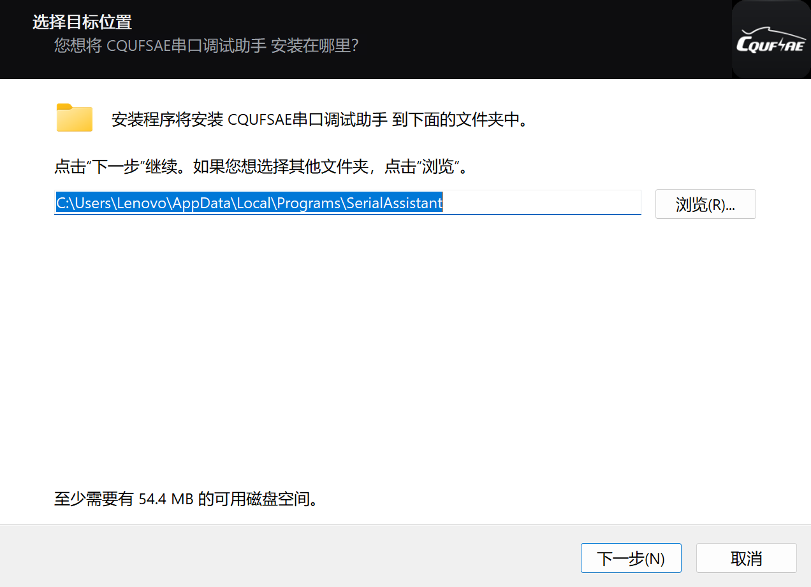

# CQUFSAE 串口调试助手

重庆大学方程式赛车队（CQUFSAE）电池组的 **BMS 数据读取与判读工具**。

车队 BMS 走串口/蓝牙往外吐数据：时间戳、电压、温度、BMS 状态混在一起。
这个工具把它们**按段正确着色、对齐，出问题时一键定位**——车检和调试时
打开就能读数，不用再肉眼在串口终端里找数字。

当前版本：**v2.1**（2026-10-17）

## 一键下载

**推荐：安装版**（可选安装位置、自动建桌面快捷方式、带卸载程序、新版自动替换旧版）

[](https://github.com/Charlie-lee123/CQUFSAEbatteryteam/releases/latest/download/SerialAssistant-setup-2.1.exe)

**免安装版**（单文件，下载后双击即用）

[](https://github.com/Charlie-lee123/CQUFSAEbatteryteam/releases/latest/download/SerialAssistant.exe)

> 两个链接都指向**最新 Release**。配置全部存在注册表，覆盖安装或替换 exe 都不会丢设置。

## 界面速览


浅色主题（跟随系统自动切换）：


## 它能做什么

### 1. 把 BMS 的原始输出变成能看的数

一轮数据里，电压超限标**红**、欠压标**绿**、温度越界标**黄**、BMS ERROR 整行标**橙**；
采样点序号补零、小数点竖向对齐，一眼能扫出异常点。


- 每轮数据一个时间戳（紫色），年 / 月 / 日各有独立显示开关
- 流式收包合并成帧（30ms 静默窗口成帧 + 双兜底），数字不会被分包拦腰截断
- 「定位最近异常」：跳到最近一次电压 / 温度越界的位置并整行高亮
- 行内搜索（Ctrl+F，区分"当前命中"与"其它命中"）、复制"正在查看的一轮"、保存日志

### 2. 两种连接方式：串口 / 蓝牙广播


- **串口**：自动扫描、插拔自动识别；波特率 / 校验位 / 数据位 / 停止位 / 编码、
  HEX 收发、定时发送
- **蓝牙广播**（v2.0 新增）：**只被动扫描 BLE 广播包，不配对、不连接、不绑定**。
  设备把数据放进广播包（manufacturer / service data 都认），这边开机就能读，
  多台电脑可同时收。代价是单向（广播模式下发送区禁用）且带宽低（单包 31 字节）。
- 建链不卡界面：慢连接期间显示「正在连接 …」，再拨一下开关即可取消

### 3. 接收区一键展开全屏（Esc 退出）

赛场屏幕小的时候，让日志独占整个窗口；暂停 = 冻结画面，新数据进后台队列，
恢复时一次性刷入并追底。

### 4. 历史数据回放

自动留存最近接收数据（行数跟随「保留行数」设置），「打开历史数据」灌进同一个
接收区——着色、搜索、定位异常、复制全部可用，赛后能复盘当时的读数。


### 5. 按需定制

设置面板可调：电压 / 温度上下限、接收区字号（无级）、保留行数、毛玻璃强度、
界面按钮显隐（防止队友误触）、启动时是否全屏等，全部实时预览。


## 交给 AI 用：MCP 一键接入

软件自带一个 **MCP（Model Context Protocol）服务**，装好之后，你的 Agent（WorkBuddy /
Claude Desktop / Cursor…）就能**直接开关串口、收发数据、等回包**，不用你手抄数字。

### 一键使用（推荐）

1. 打开软件 → 右下角 **设置**
2. 找到 **「AI 接入」** 一行 → 点 **「复制接入配置」**
3. 把复制到的这一整段**直接粘给 Agent**，说一句"按这个部署"

复制出来的内容**自包含**：装依赖的命令、MCP 服务的**全部源码**、客户端注册片段、
三条自检标准、以及串口独占的注意事项。Agent 照着做就会装好：

```text
第 1 步  建独立 venv 并 pip install mcp pyserial
第 2 步  把源码原样写成 serial_assistant_mcp.py
第 3 步  把 serial-assistant 条目合并进客户端的 mcp.json
第 4 步  自检：依赖 / 服务能起 / 客户端里列出 9 个工具
```

> 不用联网 clone 仓库，也不用你自己找路径 —— 源码是跟着 exe 一起发的。

### 命令行一键导出

不想开界面（或在别人的机器上），直接导出成文件：

```bash
SerialAssistant.exe --mcp-payload                 # 写到 exe 同级 mcp-接入配置.txt
SerialAssistant.exe --mcp-payload D:\mcp.txt      # 指定路径
```

### 它能做什么（9 个工具）

| 工具 | 作用 |
| --- | --- |
| `list_ports` | 列出串口，附带"是不是被别的程序占着"的提示 |
| `open_port` / `close_port` | 开/关串口（波特率、校验位、停止位可给） |
| `status` | 当前配置 + 收发字节数 + 还有多少行没被取走 |
| `send` | 发文本或 HEX，可选补 `\r\n` |
| `read` | **非阻塞**取走"上次之后"的新行（不阻塞、不重复） |
| `send_and_wait` | 发一条等回包（可给正则），串口调试最常用 |
| `send_repl` | 一串命令逐条发送并逐条收（初始化寄存器） |
| `clear_buffer` | 清空接收缓冲 |

⚠️ **串口是独占资源**：MCP 打开某个口期间，本软件的界面不能同时连同一个口
（反过来也一样）。让 Agent 先 `list_ports` 看一眼再动手就行。

## 快速上手

### 安装

双击 `SerialAssistant-setup-2.1.exe`，选好目录一路下一步即可（免管理员权限）。
装完自动建桌面快捷方式；以后有新版本，重新跑一遍新安装包会**自动移除旧版本**，
你的配置原封不动。



### 第一次读数（30 秒）

1. 打开软件，右上角「串口开关」上方选好**连接方式**
2. 串口：插上线 → 端口下拉里选 → 拨开关；
   蓝牙广播：点「刷新」→ 扫到设备后选带**有广播负载**的那台 → 拨开关
3. 数据自动分段着色，越界即红即绿
4. 看到异常点「定位最近异常」直接跳过去
5. 「复制本轮」把这一轮发给车队群

## 给开发者的

- **自测**：`selftest.py` 27 项用例（收发 / 着色 / 全屏 / 标题栏 / 建链 / 蓝牙广播 /
  MCP 接入包 / 安装卸载流程），`QT_QPA_PLATFORM=windows .venv/Scripts/python.exe selftest.py`
- **打包**：`build.bat`（PyInstaller）→ 产物在 `dist/`，复制到 `发布/`
- **安装包**：`python devtools/_build_installer.py`（Inno Setup，版本号从 version.py 现读；
  向导图先跑 `python devtools/_make_installer_art.py` 生成）
- **安装/卸载体检**：`python devtools/_installer_check.py`（隔离目录全流程，不动真实安装）
- **静态检查**：`ruff check --select F,E7,E9 *.py devtools/*.py` + `vulture *.py`（基线零告警）
- **MCP 服务**：`mcp/serial_assistant_mcp.py`（stdio，独立于 GUI 进程）；接入包文案在
  `mcp_bridge.py`，源码由 `SerialAssistant.spec` 打进 exe（`datas` 里的 `mcp/`），
  改完服务记得重打包 —— 否则设置面板复制出来的还是旧源码

## 数据格式约定

工具按如下边界切分段落（与车队 BMS 的实际输出一致）：

```
[时间戳]                ← 新的一轮开始，电压段从此处起
1.3820 2.3824 …         ← 电压数据（按 电压上下限 判红 / 绿）
Temperature1:
1.22 2.95 …             ← 温度数据（按 温度上下限 判黄）
BMS ERROR               ← BMS 状态（橙），到此为止：其后的数值不再参与分段
```

- 采样点格式为 `序号.值`，电压值的单位是 mV、温度是 ℃（均取小数点后的整数部分）
- 段落边界以**时间戳**和 `Temperature1:` / `BMS` 为准，不依赖 `Voltage1:` 标题是否存在
- 蓝牙广播模式下，把上述文本（含换行）放进广播包的 manufacturer data 即可，
  软件按同样的规则切分

## 版本

| 版本 | 日期 | 说明 |
| --- | --- | --- |
| v1.0 | 2026-10-10 | 首个发布版本，项目备份基线 |
| v1.1 | 2026-10-10 | 异常定位优先电压；数值段补零对齐；BMS ERROR 改橙色；修复设置面板滑轨与内容重叠；README 一键下载 |
| v1.2 | 2026-10-11 | 序号 0 不再补占位空格；修复拨动开关点不动/滑轨错位；开关改为按下即翻转；设置面板底部新增版本号、检查更新（自动比对 GitHub 最新 tag）与仓库地址链接 |
| v1.3 | 2026-10-11 | 电压/温度数据等宽网格对齐（列距统一、短行并回）；折行按视口宽度封顶；分包劈开的半行自动接回；温度与 BMS 明细行序号不再补 0；BMS 错误明细整块标橙 |
| v1.4 | 2026-10-12 | 新增「默认折叠发送区」定制项；修复拨动开关命中区过大；修复保存退出设置后最大化窗口四角出现缝隙 |
| v1.5 | 2026-10-12 | 修复「复制本轮」数据不完整；新增「高亮异常数据」开关；新增「接收区字体大小」无级调节；设置面板新增「导出日志」；修复退出最大化后无缩放光标；串口配置栏文字按实测墨迹竖直居中 |
| v1.6 | 2026-10-12 | 下拉选择全面统一成展开交互：「保留行数」改可编辑下拉；弹层宽度自适应；所有下拉弹层 150ms 展开动画；修复弹层黑条与直角 |
| v1.7 | 2026-10-12 | 检查更新重构（多源回退 + 自动更新 + SHA256 校验）；历史接收数据自动留存；修复欠压绿色高亮越界 |
| v1.8 | 2026-10-13 | 安装程序与卸载程序（Inno Setup）；本地留存行数与接收区一致；软件内回放留存数据 |
| v2.0 | 2026-10-15 | **蓝牙广播接收**（只扫描、不配对、不绑定）+「连接方式」切换 + `--ble-scan` 探针；**建链不卡界面**（可取消）；整项目瘦身（3.7GB→0.9GB）；安装器主题化 + 自动移除旧版本；修复自动更新「退出并重启」报错等 3 处问题 |
| v2.1 | 2026-10-17 | **MCP 接入**（9 个工具的串口服务，源码随包走；设置面板「AI 接入」一键复制部署包，粘给 Agent 即自动装好；`--mcp-payload` 命令行导出）；**包体 52.6MB → 35.2MB（−33%）**（剔除 QML/Pdf/软件 OpenGL 等 41MB 无用运行时）；**冷启动导入 −23%**（蓝牙模块改为惰性加载）；清理死代码与孤儿通道；修复普通窗口几何被写成无效值 |

## License

见 [LICENSE](LICENSE)。
