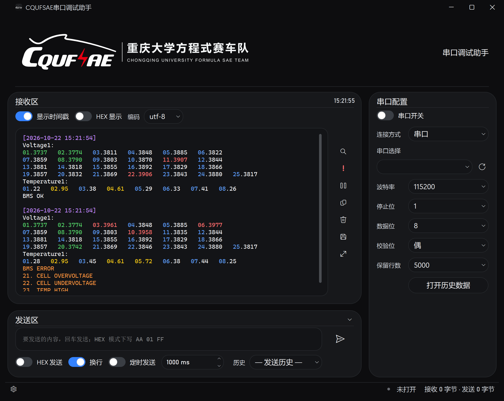
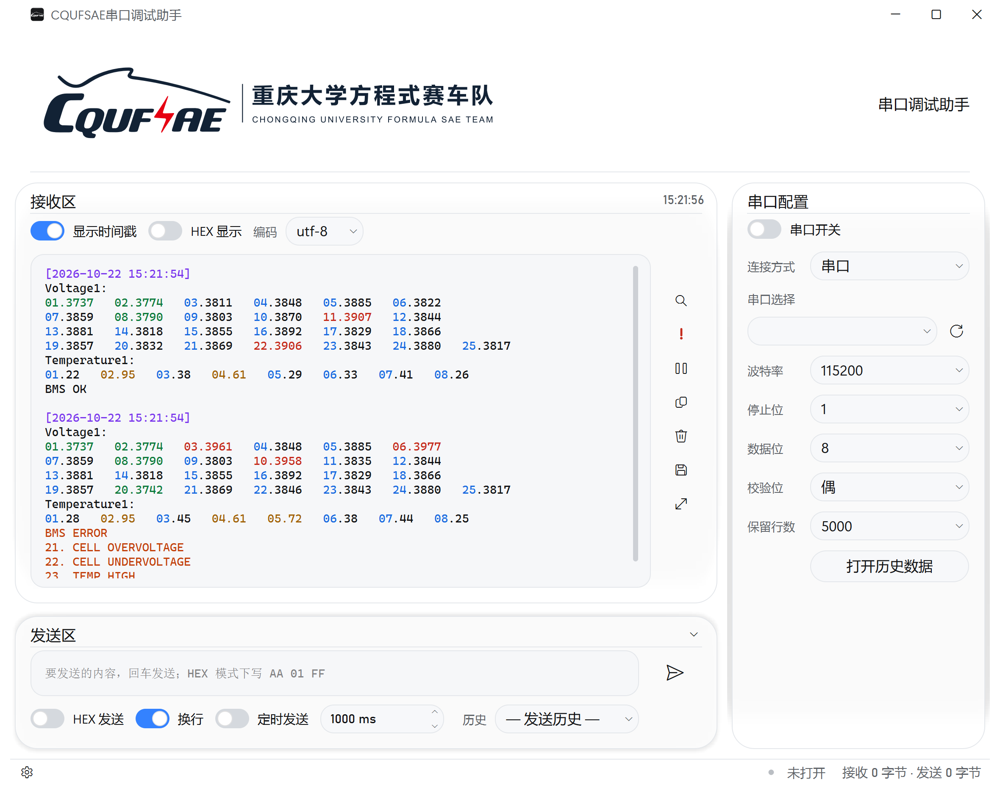
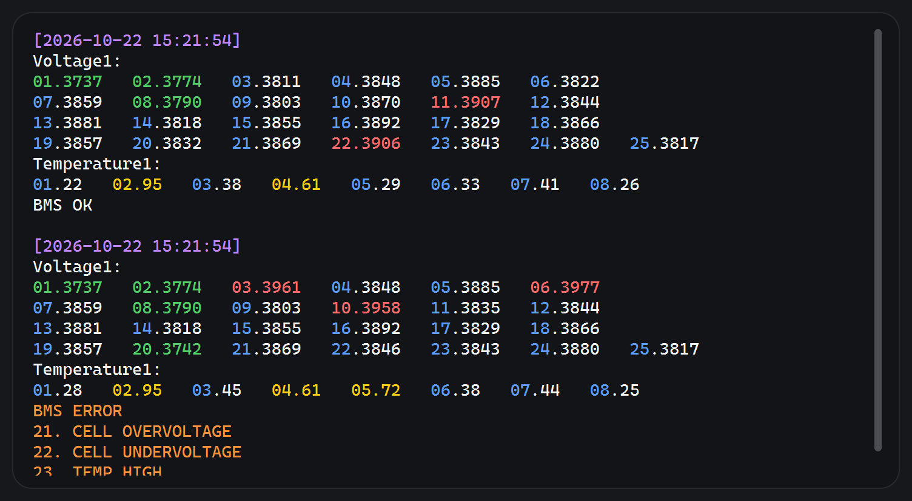
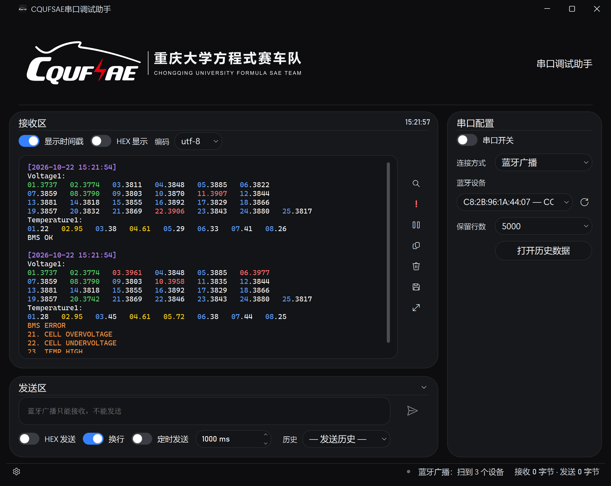
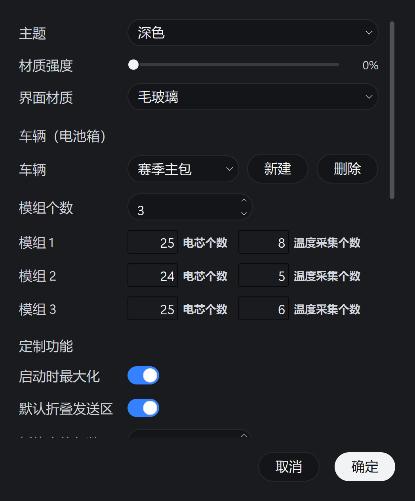

# CQUFSAE 串口调试助手

重庆大学方程式赛车队（CQUFSAE）电池组的 **BMS 数据读取与判读工具**。

车队 BMS 走串口 / 蓝牙往外吐数据：时间戳、电压、温度、状态码混在一起。这个工具不
是通用串口终端，它**认识这些数据**——按段正确着色、把采样点排成等宽网格、出问题时
一键跳到异常点。车检和调试时打开就能读数，不用再肉眼在终端里找数字。

当前版本：**v2.2**（2026-10-18）· Windows 10 / 11（64 位）· 约 35 MB

## 一键下载

**推荐：安装版**（可选安装位置、自动建桌面快捷方式、带卸载程序、新版自动替换旧版）

[](https://github.com/Charlie-lee123/CQUFSAEbatteryteam/releases/latest/download/SerialAssistant-setup-2.2.exe)

**免安装版**（单文件，下载后双击即用）

[](https://github.com/Charlie-lee123/CQUFSAEbatteryteam/releases/latest/download/SerialAssistant.exe)

> 两个链接都指向**最新 Release**。界面上看不到菜单和标题栏按钮之外的多余东西——
> 无边框窗口、黑白灰配色，唯一的高饱和色是开关的蓝。

## 界面速览

深色（跟随系统主题）：



浅色：



---

## 为什么用它（主要特色）

1. **认识 BMS 的数据格式**——电压 / 温度 / BMS 状态各成一段，越界标红标绿标黄，
   采样点序号补零、小数点竖向对齐。段边界以时间戳和 `Temperature1:` / `BMS` 判定，
   不依赖 `Voltage1:` 标题是否存在。
2. **免配对的蓝牙广播**——只被动扫 BLE 广播包，不连接、不绑定，开机就能读，多台电脑
   可以同时收（代价是单向、带宽低）。
3. **数据不丢**——暂停是"冻结画面"而不是停收；历史数据自动留存可回放；**升级安装
   也不再覆盖日志和接收历史**（v2.2 起存在 `%LOCALAPPDATA%`）。
4. **动效是一套体系**——所有展开/收起/定位都走同一条补间时间线，没有"啪一下"的跳变；
   帧率可调到显示器刷新率上限（默认跟随显示器）。
5. **一台车一套结构**——车辆档案里存着模组个数与**每个模组**的电芯/温度采集数，
   换车换档案，不用每次手改三遍参数；接收区按模组排版。
6. **能给 AI 用**——内置 MCP 服务，你的 Agent 可以直接开关串口、收发数据、等回包。

## v2.2 新特性

- **升级不再丢用户数据**：日志与接收历史搬到 `%LOCALAPPDATA%\CQUFSAE-SerialAssistant`，
  安装器拆旧版前先备份再搬回。
- **动画逐帧审计**：设置面板打开/关闭的"最后一帧闪 / 整体往左跳"（真根因是 DWM 扩展
  边框裁剪符号写反，快照位图右偏 7px）、退出最大化时发送区整块弹出、暂停/恢复的三处
  硬跳，全部改成连续补间。
- **接收区暂停/恢复更顺**：暂停定位的 190px 跳变改为 200ms 缓动滚动；时间戳工具栏按
  行高 240ms 收展；恢复追底也走 180ms 补间。
- **历史数据改「打开/关闭」开关**，带展开提示条动画。
- **设置面板「AI 接入」改名「MCP Service」**（功能不变，文案更直白）。
- **多车型档案**：设置里新增「车辆（电池箱）」，可新建/删除、**直接在选车框里改名**；
  选车即定模组个数，每个模组的「电芯个数 / 温度采集个数」手动输入；接收区按
  “一排 = 一个模组”排版，装不下时在模组内均衡拆行，不漏点、不留孤格。
  没选车时行为与旧版完全一致。
- **蓝牙设备下拉**：修掉打开时“满高闪一帧再缩回去”的跳变，弹层宽度按屏幕封顶、
  位置夹进屏幕可用区（不再有半截跑出屏幕），超长条目用省略号。
- 代码净化：定制配置 O(1) 索引、删除死代码、静态检查零告警。

> 每次发布的完整清单见 [Releases](https://github.com/Charlie-lee123/CQUFSAEbatteryteam/releases)。

---

## 功能详解

### 1. 接收区：分段着色与等宽网格



- **按段着色**：电压高于上限**红**、低于下限**绿**；温度越界**黄**；`BMS ERROR`
  字样**橙**（其后的错误明细行保持设备原样，方便原样抄给电控）。
- **等宽网格**：电压 / 温度按视口宽度重排成等宽列，短行并回、长行按视口封顶折行；
  电压段序号补零对齐，温度段和 BMS 明细行的序号保持设备原样。
- **时间戳**：每一轮数据开头挂一条紫色时间戳（年 / 月 / 日各有独立显示开关）。
- **不劈行**：串口一次 read 只给半行，这里按 30ms 静默窗口成帧（另有 200ms 与半行
  缓发的双兜底），数字不会被分包拦腰截断。

### 2. 异常判读

- **定位最近异常**：从文档末尾往前找最近一行越界值或 `BMS ERROR`，滚过去并**持久
  高亮**该行——车检时"刚才是不是报错了"一眼就能回答。
- **上下限可调**：电压 / 温度阈值在设置里改，判读实时跟着变（默认 3800–3900 mV、
  0–60 ℃）。
- **高亮异常数据**总开关：截图或投屏时想看得清爽可以关掉着色。

### 3. 接收区工具（右侧七颗）

搜索、定位最近异常、暂停/继续、复制当前一轮、清空、保存日志、全屏。

- **搜索**（`Ctrl+F`）：区分"当前命中"和"其它命中"，`↑`/`↓` 跳转，无命中会明确提示。
- **复制当前一轮**：把正在看的那一轮（含时间戳）整段抄进剪贴板，直接发车队群。
- **保存日志** / **清空**（`Ctrl+L`）：清空不动历史文件。
- **全屏**（`F11`，`Esc` 退出）：赛场小屏幕上让日志独占整个窗口。

### 4. 暂停 = 冻结画面

按空格或点暂停键：画面立即钉住（新数据仍在后台接收、仍然写历史），同时自动把发送区
折起来多给日志一截高度，并把当前轮的时间戳**平滑**对到视口下方 7 行——一眼能对上
"这是哪一轮"。恢复时一次性刷入积压数据并回到最新（追底也是缓动的）。

### 5. 历史数据回放

接收数据按「保留行数」自动留存在本地，「打开历史数据」把文件灌进同一个接收区——着色、
搜索、定位异常、复制全部可用，赛后可以复盘当时的读数。记录功能可在设置里一键关闭。

### 6. 两种连接方式

- **串口**：自动扫描端口、插拔自动识别；波特率 / 校验位 / 数据位 / 停止位 / 编码
  可调；支持 HEX 收发、定时发送、发送历史。建链是**异步**的——慢连接期间显示
  「正在连接 …」，随时可取消，界面不卡。
- **蓝牙广播**：只被动扫描 BLE 广播包（manufacturer data / service data 都认），
  **不配对、不连接、不绑定**；扫到的设备带信号强度和"有没有广播负载"标注，挑有负载的
  那台拨开关即可。代价是单向（发送区禁用）且单包 31 字节。



### 7. 多车型：一套电池箱结构一份档案

不同车的电池箱不一样——模组个数不同、每个模组的电芯数和温度采集数也可能不同（比如
25 / 24 / 25）。设置里的「车辆（电池箱）」就是为这件事准备的：


- **一台车 = 一套结构**：可新建、删除，名字随你起（「2026 赛季主包」「备用箱」…）。
- **改名就在选车框里**：选中车之后直接改写框里的名字，回车或点别处生效；重名和空名
  会被拒绝并回滚（不用另找一行「车辆名称」）。
- **选车即定模组个数**：选中一台车，它的模组个数就生效；改模组个数，下面的逐模组行
  跟着增删（新增的模组沿用最后一个模组的配置）。
- **逐模组单独填**：模组 1 电芯 25 / 温度 8，模组 2 电芯 24 / 温度 5…… 写几个模组就
  生成几行。两个数量框（「电芯个数」「温度采集个数」）都是**手动输入**：直接敲数字，
  回车或点别处生效，0~999 任意值，非法输入自动回滚。
- **接收区按模组排版**：一排 = 一个模组；窗口装不下一个模组时，在**这个模组内部**按
  视口均衡拆成几排（如 25 → 12+13），行尾不会甩出孤零零一个单元格，点数一个不丢。
- **没选车时行为不变**：退回「定制功能」里的三个全局参数（模组个数 / 每模组电芯数 /
  每模组温度采集数），0 = 跟随设备发来的每行点数，与老版本完全一致。

### 8. 定制与设置



- **外观**：主题（深 / 浅 / 跟随系统）、材质强度无级滑杆、界面材质（毛玻璃 / 液态玻璃）、
  动画帧率（可到显示器上限）—— 强度紧跟在主题下面，材质跟着强度，两个是一对。
- **行为**：启动时最大化、默认折叠发送区、暂停定位行数、时间戳年月日、时钟年月日。
- **判读**：电压 / 温度上下限、高亮异常数据、接收区字号（无级）。
- **BMS 结构**：未选车时用这三个全局参数（模组个数 / 每模组电芯数 / 每模组温度采集数，
  0 = 自动）；选了车则由车辆档案接管。
- **界面按钮**：逐颗开关右侧功能键，防止队友误触。
- **日志 / 接收历史**：显示存放路径、导出日志、历史记录开关。
- **MCP Service**：一键复制给 Agent 的接入包（见下节）。
- 底部有版本号、**检查更新**和仓库地址。

### 9. 自动更新

「检查更新」发现新版本会弹窗（立即更新 / 本次会话不再提醒 / 前往仓库）。应用内更新
先走镜像源下载，再做 **SHA256 完整性校验**，校验通过才静默替换并重启——配置和历史
数据完整保留。安装版用户也可以直接重跑新安装包，安装器会自动移除旧版本。

---

## 交给 AI 用：MCP Service

软件自带一个 **MCP（Model Context Protocol）服务**，装好之后，你的 Agent（WorkBuddy /
Claude Desktop / Cursor…）就能**直接开关串口、收发数据、等回包**，不用你手抄数字。

### 一键使用（推荐）

1. 打开软件 → 右下角 **设置**
2. 找到 **「MCP Service」** 一行 → 点 **「复制接入配置」**
3. 把复制到的这一整段**直接粘给 Agent**，说一句"按这个部署"

复制出来的内容**自包含**：装依赖的命令、MCP 服务的**全部源码**、客户端注册片段、
三条自检标准、以及串口独占的注意事项。Agent 照着做就会装好：

```text
第 1 步  建独立 venv 并 pip install mcp pyserial
第 2 步  把源码原样写成 serial_assistant_mcp.py
第 3 步  把 serial-assistant 条目合并进客户端的 mcp.json
第 4 步  自检：依赖 / 服务能起 / 客户端里列出 9 个工具
```

> 不用联网 clone 仓库，也不用你自己找路径——源码是跟着 exe 一起发的。

### 命令行一键导出

不想开界面（或在别人的机器上），直接导出成文件：

```bash
SerialAssistant.exe --mcp-payload                 # 写到 exe 同级 mcp-接入配置.txt
SerialAssistant.exe --mcp-payload D:\mcp.txt      # 指定路径
```

### 它提供哪些工具（9 个）

| 工具 | 作用 |
| --- | --- |
| `list_ports` | 列出串口，附带"是不是被别的程序占着"的提示 |
| `open_port` / `close_port` | 开/关串口（波特率、校验位、停止位可给） |
| `status` | 当前配置 + 收发字节数 + 还有多少行没被取走 |
| `send` | 发文本或 HEX，可选补 `\r\n` |
| `read` | **非阻塞**取走"上次之后"的新行（不阻塞、不重复） |
| `send_and_wait` | 发一条等回包（可给正则），串口调试最常用 |
| `send_repl` | 一串命令逐条发送并逐条收（初始化寄存器） |
| `clear_buffer` | 清空接收缓冲 |

⚠️ **串口是独占资源**：MCP 打开某个口期间，本软件的界面不能同时连同一个口（反过来
也一样）。让 Agent 先 `list_ports` 看一眼再动手就行。

---

## 快速上手

### 安装

双击 `SerialAssistant-setup-2.2.exe`，选好目录一路下一步即可（免管理员权限）。装完
自动建桌面快捷方式；以后有新版本，重新跑一遍新安装包会**自动移除旧版本**，你的配置、
日志和接收历史都原封不动。

也可以直接用免安装的 `SerialAssistant.exe`，双击即用（配置同样存在注册表里，
覆盖 exe 不会丢设置）。

### 第一次读数（30 秒）

1. 打开软件，右侧「串口配置」上方选好**连接方式**
2. 串口：插上线 → 端口下拉里选 → 拨开关；
   蓝牙广播：点「刷新」→ 扫到设备后选带**有广播负载**的那台 → 拨开关
3. 数据自动分段着色，越界即红即绿
4. 看到异常点「定位最近异常」直接跳过去
5. 「复制本轮」把这一轮发给车队群

---

## 数据格式约定

工具按如下边界切分段落（与车队 BMS 的实际输出一致）：

```
[时间戳]                ← 新的一轮开始，电压段从此处起
1.3820 2.3824 …         ← 电压数据（按 电压上下限 判红 / 绿）
Temperature1:
1.22 2.95 …             ← 温度数据（按 温度上下限 判黄）
BMS ERROR               ← BMS 状态（橙），到此为止：其后的数值不再参与分段
```

- 采样点格式为 `序号.值`，电压单位 mV、温度单位 ℃（都取小数点后的整数部分：
  `2.95` = 95 ℃）
- 段落边界以**时间戳**和 `Temperature1:` / `BMS` 为准，不依赖 `Voltage1:` 标题是否存在
- 蓝牙广播模式下，把上述文本（含换行）放进广播包的 manufacturer data 即可，软件按
  同样的规则切分

---

## 给开发者的

- **自测**：`selftest.py` 27 项用例（收发 / 着色 / 全屏 / 标题栏 / 建链 / 蓝牙广播 /
  MCP 接入包 / 安装卸载流程）
  `QT_QPA_PLATFORM=windows .venv/Scripts/python.exe selftest.py`
- **打包**：`build.bat`（PyInstaller）→ 产物在 `dist/`，复制到 `发布/`
- **安装包**：`python devtools/_build_installer.py`（Inno Setup，版本号从 `version.py`
  现读；向导图先跑 `python devtools/_make_installer_art.py` 生成）
- **安装/卸载体检**：`python devtools/_installer_check.py`（隔离目录全流程，不动真实安装）
- **README 配图**：`python devtools/_make_readme_shots.py`（用当前代码现渲染，深/浅主题
  各一张，数据是造的、裁剪按控件几何现算——改版之后重跑一次就行）
- **静态检查**：`ruff check --select F,E7,E9 *.py devtools/*.py` + `vulture *.py`（基线零告警）
- **MCP 服务**：`mcp/serial_assistant_mcp.py`（stdio，独立于 GUI 进程）；接入包文案在
  `mcp_bridge.py`，源码由 `SerialAssistant.spec` 打进 exe（`datas` 里的 `mcp/`），
  改完服务记得重打包——否则设置面板复制出来的还是旧源码

## 版本

| 版本 | 日期 | 说明 |
| --- | --- | --- |
| v1.0 | 2026-10-10 | 首个发布版本，项目备份基线 |
| v1.1 | 2026-10-10 | 异常定位优先电压；数值段补零对齐；BMS ERROR 改橙色；修复设置面板滑轨与内容重叠；README 一键下载 |
| v1.2 | 2026-10-11 | 序号 0 不再补占位空格；修复拨动开关点不动/滑轨错位；开关改为按下即翻转；设置面板底部新增版本号、检查更新与仓库地址链接 |
| v1.3 | 2026-10-11 | 电压/温度数据等宽网格对齐（列距统一、短行并回）；折行按视口宽度封顶；分包劈开的半行自动接回；温度与 BMS 明细行序号不再补 0 |
| v1.4 | 2026-10-12 | 新增「默认折叠发送区」定制项；修复拨动开关命中区过大；修复保存退出设置后最大化窗口四角出现缝隙 |
| v1.5 | 2026-10-12 | 修复「复制本轮」数据不完整；新增「高亮异常数据」开关；新增「接收区字体大小」无级调节；设置面板新增「导出日志」；修复退出最大化后无缩放光标 |
| v1.6 | 2026-10-12 | 下拉选择全面统一成展开交互：「保留行数」改可编辑下拉；弹层宽度自适应；所有下拉弹层 150ms 展开动画；修复弹层黑条与直角 |
| v1.7 | 2026-10-12 | 检查更新重构（多源回退 + 自动更新 + SHA256 校验）；历史接收数据自动留存；修复欠压绿色高亮越界 |
| v1.8 | 2026-10-13 | 安装程序与卸载程序（Inno Setup）；本地留存行数与接收区一致；软件内回放留存数据 |
| v2.0 | 2026-10-15 | **蓝牙广播接收**（只扫描、不配对、不绑定）+「连接方式」切换 + `--ble-scan` 探针；**建链不卡界面**（可取消）；整项目瘦身（3.7GB→0.9GB）；安装器主题化 + 自动移除旧版本；修复自动更新「退出并重启」报错等 3 处问题 |
| v2.1 | 2026-10-17 | **MCP 接入**（9 个工具的串口服务，源码随包走；设置面板一键复制部署包，粘给 Agent 即自动装好；`--mcp-payload` 命令行导出；该入口 v2.2 起名为「MCP Service」）；**包体 52.6MB → 35.2MB（−33%）**；**冷启动导入 −23%**（蓝牙模块惰性加载）；清理死代码与孤儿通道；修复普通窗口几何被写成无效值 |
| v2.2 | 2026-10-18 | **动画逐帧审计与修复**：设置面板打开/关闭「最后一帧闪/往左跳」真根因（DWM 扩展边框裁剪符号写反，快照位图右偏 7px）与换帧白帧竞态；退出最大化时发送区整块弹出；串口开关展开回抽；搜索条改 220ms；接收区转场改为单补间驱动。**升级保留用户数据**（日志与接收历史迁到 `%LOCALAPPDATA%`，安装器拆旧版前备份再搬回）。历史数据改「打开/关闭」toggle。**暂停/恢复动画改补间驱动**（工具栏收展、暂停定位滚动、恢复追底都不再硬跳）。「AI 接入」改名「MCP Service」。代码净化（定制配置 O(1) 索引、去死代码、静态检查零告警）。**多车型档案**（车辆可增删改名，选车即定模组个数，逐模组配置电芯/温度采集数，接收区按模组排版且在模组内均衡拆行）；**蓝牙设备下拉**修掉开合跳变与出屏 |

## License

见 [LICENSE](LICENSE)。
