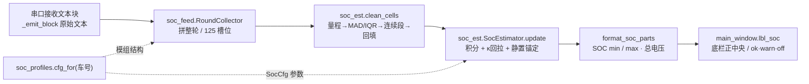
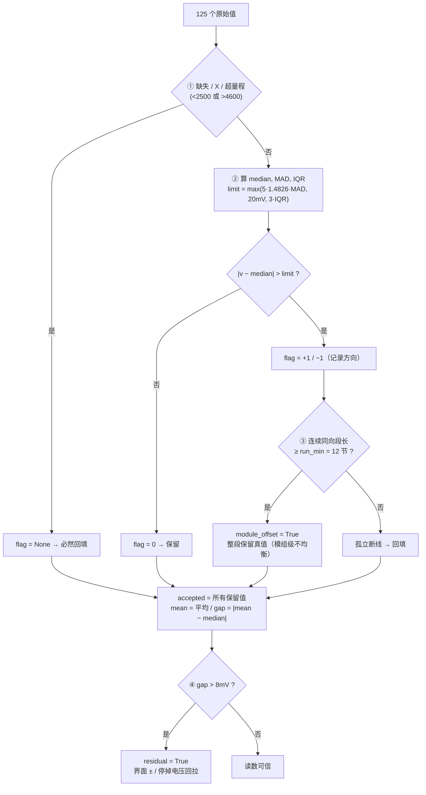
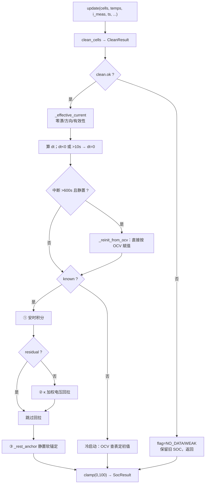

# E74 电池 SOC 估算 —— 技术实现说明

> 适用版本：SerialAssistant 2.7（含 SOC 功能，2026-11-11）
> 适用对象：2026 中国大学生方程式 · 重庆大学方程式赛车队 E74 号车
> 电池：5 模组 × 25 电芯 = **125 串**，12.041 Ah，高电压 NCM 三元锂
> 本文说明**怎么实现**、**为什么这么实现**、以及**哪些结论不能说**。

---

## 0. 一页速览

一句话：**安时积分做骨架，端电压做可信度加权回拉，静置时做一次软锚定；进来之前先用物理判据把断线和模组不均衡分开。**

```
串口文本 → 拼成整轮(125节) → 清洗+回填 → 均值×125 得总压
                                   ↓
        ┌──────────────── 安时积分(短期准) ───────────────┐
        │                                                  ├→ SOC → 底栏正中
        └── OCV查表 + κ加权回拉(长期准) / 静置软锚定 ──────┘
```

### 需求 → 实现对照

| 原始需求 | 落地位置 | 实现要点 |
|---|---|---|
| 剔除异常数据、可能有短/断线 | `soc_est.clean_cells()` | 量程筛 + MAD/IQR + **连续段长度**三道判据 |
| 断线的电压用健康电芯平均值替换 | 同上 | `keep=False` 的位置一律写 `mean`；均值只算一次，不二次稀释 |
| 注意平均值和中位数的差，太大说明没剔干净 | `CleanResult.gap_mv` | 均值−中位数之差的绝对值 > 8 mV → `residual=True`，界面加 `±` 并**停掉电压回拉** |
| 判断数据真伪 | `soc_feed` + `soc_est` | `-250 A` 轨值整帧作废、序号单调递增守卫、接触器粘滞、温度取中位数 |
| 总电压用平均值估算 | `CleanResult.pack_mv` | `健康均值 × 125 / 1000` V（车上 `V=` 传感器已坏，恒 0） |
| 实时 SOC + 总电压放最下方正中央 | `main_window._place_soc()` | 底栏子控件绝对定位，`(栏宽−自身宽)/2`，`resizeEvent` 跟随 |
| 预留别的车辆的 SOC 入口 | `soc_profiles.py` | 按**车号**查参数，独立键 `custom/soc_packs`；没配的车显示 `--` |
| 用 E74 历史数据测准确性/精确性 | `devtools/_soc_backtest.py` | 119 轮日志 + 499 轮会话库，见第 9 章 |
| **（新增）设置里可切四状态 EKF** | `customization.register_bool("soc_ekf4")` + `soc_ekf.py` | 开 = 二阶 RC-PNGV `[SOC,U₁,U₂,Uc]` 扩展卡尔曼滤波；关 = 上面的固定增益融合，默认关，见第 11 章 |
| **（新增）SOC 只显示 max 和 min** | `soc_est.format_soc_parts()` | 最低/最高**真实**单体电压分别查 OCV 表；放电突出 min、充电突出 max，见第 12 章 |
| **（新增）回看历史必带时间戳** | `_emit_block` / `_rows_with_stamps()` | 落盘与显示解耦；老文件用 `[--:--:--]` 占位、不伪造时刻，见第 13 章 |
| **（新增）没接负载也要能判断充放电** | `soc_est.WorkModeClassifier` | 接触器状态 > 有效电流 > 电压趋势；待机默认突出 min 并标工况，见第 14 章 |

> ⚠️ 本文件第 1~10 章描述的是 **2026-11-10 初版**链路（开关关闭时逐字保持）。
> 2026-11-11 的三项扩展见 **第 11 / 12 / 13 章**，涉及显示格式与 QSS 选择器时以新章为准。

---

## 1. 我们手上到底有什么（输入与数据取证）

### 1.1 报文结构

一轮完整报文固定是这个顺序（`RoundCollector` 就按它判边界）：

```
Voltage1:                      ← 模组 1，序号在模组内部从 01 重排
  01.3180  02.3181 ... 25.3184        值单位 mV；坏点后面带 X
Voltage2:  ... 25 点
Voltage3:  ...
Voltage4:  ...
Voltage5:  ...
Temperature1:  01.41  02.42 ... 08.43   每模组 8 个温度点
... Temperature5:
BMS OK / BMS ERROR
COM0=0
AIR+=0,AIR-=0,PRE=0            ← 接触器状态（三个全 0 = 母线断开）
V=0.00,I=1.89                  ← 整包电压 / 电流
CVMax=5446, Min=0              ← 一轮收尾行
```

可观测信号只有三样：**125 路单体端电压**、**40 路模组温度**、**母线电流**。没有库仑计、没有能量计量芯片、没有带 SOC 标签的放电记录。这决定了算法只能是「积分 + 电压」的组合。

### 1.2 真机取证：四个必须知道的坑

这些不是假设，是把 `接收历史-E74-2026.log`（119 轮）和 `logs/sessions.db`（4995 行 / 499 轮）跑了一遍之后量出来的：

1. **`V=` 总压传感器是坏的**：读数恒 `0.00~1.71 V`。所以总压**只能**用平均值估算，这不是偏好而是唯一选择。
2. **电流有一段 `-250 A` 的平滑轨值**，占会话库样本约 40%。它不是噪声，是传感器另一种状态下的饱和值；12 Ah 的包物理上不可能有 250 A。不挡住它，几帧就能把 SOC 推出十几个百分点。
3. **每轮稳定有约 8 个坏点**（掉字符 / 超量程 / `X` 标记），脏 token 率约 4%。清洗必须能容忍这个量级，又不能被它污染统计量。
4. **`AIR+=` 那一行只在约 60% 的报文块里出现**（638 块里 380 块带）。缺了它，接触器状态就成了"未知"，估算器只好拿带零漂的电流去积分，SOC 会被那点偏置慢慢推走。

另外两个时序事实：采样周期抖动 **0.9~2.5 s**（不是稳定 1 Hz）；`AIR+/AIR-/PRE` 全 0 却读到 `I ≈ 1.16 A`，说明**电流有零漂**。

---

## 2. 整体架构

### 2.1 四层数据流



### 2.2 模块职责

| 文件 | 依赖 Qt？ | 职责 |
|---|---|---|
| `soc_est.py` | **否** | OCV 表与查表、清洗、`SocEstimator`、显示格式化。纯 Python，可脱离界面单测 |
| `soc_feed.py` | **否** | 流式文本 → 整轮 `RoundData`（拼包、防错位、状态粘滞） |
| `soc_profiles.py` | 是（`QSettings`） | 按车号取 `SocCfg`，内置表 + 自定义配置的读写 |
| `main_window.py` | 是 | 底栏控件、喂数据、刷新三态；约 120 行接入代码 |
| `ui_theme.py` | 是 | 三态配色 QSS |

### 2.3 为什么把算法做成纯 Python

有意的取舍，不是图省事：

- E74 的阈值全部来自真机数据统计，必须能拿 119 轮日志 + 499 轮会话库**离线重跑**来标定；算法里但凡 `import Qt`，回测就得开窗口、就会碰 QSettings。
- 清洗和融合是纯函数/有状态对象，`devtools/_verify_soc.py` 的 117 项断言可以毫秒级跑完，不需要 GUI。
- 接收链路是主界面最热的路径，算法模块无 Qt 意味着它不会触发任何样式重算或事件循环嵌套。

代价是 `SocEstimator` 自己管时间戳（`ts=time.monotonic()` 由主窗口传入），而不是用 `QElapsedTimer`。

---

## 3. 第一层：报文 → 整轮（`soc_feed.py`）

### 3.1 为什么需要这一层

接收区是**流式**的：一个文本块可能是半轮、一轮，也可能跨两轮（分包抖动、暂停恢复、断线重连）。SOC 估算要凑齐 125 节才有意义，所以中间必须有一层明确回答"这一轮收到了什么、缺了哪些"。`RoundData` 里的槽位一律先铺成 `[None] * 125`，缺哪节一目了然。

### 3.2 协议正则

| 常量 | 表达式 | 说明 |
|---|---|---|
| `VOLT_HEADER` | `^Voltage\s*(\d+)\s*:` | 允许设备多打空格 |
| `TEMP_HEADER` | `^Temperature\s*(\d+)\s*:` | 同上 |
| `SAMPLE` | `(?<![\d.])(\d{1,2})\.(\d{1,4})(?![\d.])\s*(X)?` | 前后都卡住，防止 `13.3184` 被吃成 `3.3184`；值允许 3~4 位（掉字符就是 3 位）；`X` 是坏点标记 |
| `CVI_RE` | `V\s*=\s*(...)\s*,\s*I\s*=\s*(...)` | 取出 `V=`, `I=` |
| `CTRL_RE` | `AIR\+=... AIR-=... PRE=...` | 三个接触器 |
| `END_RE` | `^CVMax\s*=` | 一轮收尾 |

### 3.3 整轮边界：看「段状态」而不是看 `Voltage1:`

真机实测**电压数据会被分包成多帧，每帧都带自己的 `Voltage1:` 标题**。所以"见到 `Voltage1:` 就是新一轮"是错的 —— 一轮会被劈成好几段，每段只有几个电芯。

正确判据：`module == 0 and self._section != "volt"`，即**段状态从「非电压段」回到「电压段」**才算新一轮。收尾除了 `CVMax=` 行，也允许被下一轮 `Voltage1:` 顶出来（按 `complete=False` 交出）。

> ⛔ `END_RE` 收尾分支里只能调 `_begin()`，**不能调 `reset()`** —— `reset()` 会连接触器粘滞状态一起忘掉，等于每轮都重新开始继承。

### 3.4 电芯定位：键必须是 `(模组号, 序号)`

报文里序号在**每个模组内部从 01 重新开始**。只按序号存，模组 2 会覆盖模组 1，最后只剩 25 节数据，而且界面看起来一切正常 —— 这是本模块最难发现的坑。

落到整串的下标：

```
idx = 模组号(0基) × cells_per_module + 序号(1基) − 1
```

### 3.5 三个防错机制

1. **序号单调递增守卫** `_last_seq`：掉字符会造出「值合法但序号错位」的假样本（`13.3184` 被劈成 `1` + `3.3184`，后者会冒充第 3 节）。要求 `seq > _last_seq` 才收。
2. **懒铺槽位**：`_take_cells()` / `_take_temps()` 开头检查 `if not self._round.cells: self._begin()`，保证没见过协议头也不会越界。
3. **接触器粘滞继承** `STICKY_ROUNDS = 10`：这一轮没带 `AIR+=` 行时沿用上一次已知状态，最多 10 轮。物理状态不会因为某一块没带这行就消失；给上限是防止反过来把 SOC 冻住（万一接触器真的闭合而那行再不出现）。

### 3.6 为什么用原始文本

`_feed_soc(text)` 挂在 `_emit_block` 里 `_feed_export(text)` 之后，拿的是**对齐/补零之前**的原始文本。对齐会把电压重排成网格、在断线处插 `X`，按那个取数会把"第几个电芯"算错。

---

## 4. 第二层：数据清洗（`soc_est.clean_cells`）

### 4.1 需求口径

> 「剔除异常数据，断线的电压用没有断线的电芯电压平均值替换；注意平均值和中位数的差值，太大了说明还是有断线没有剔除干净。」

这里有个关键判断：**"断线"和"整模组不均衡"在数据上长得很像（一片连续的高/低值），但物理含义完全相反**。断线要回填，不均衡要保真值。整个清洗算法的核心就是把这两者分开。

### 4.2 算法分步



**第一步：量程筛。** 只保留 `2500 ≤ v ≤ 4600 mV`（NCM 放空 3.00 V、满充 4.50 V，留余量）。超量程是掉字符/错位最常见的表现。

**第二步：稳健离群门槛。**

```
median = median(healthy)
MAD    = median(|v_i − median|)
IQR    = q3 − q1
limit  = max( 5 × 1.4826 × MAD ,  20.0 mV ,  3 × IQR )
```

用 **MAD 而不是标准差**：标准差本身被离群点污染，断线越多门槛越松。`1.4826` 是 MAD 到正态分布 σ 的一致化系数。

为什么要加 `3×IQR`：MAD 在"少数派整体偏移"时会塌成 0（例：40 节读 3300、85 节读 3200，中位数仍是 3200，MAD=0），此时只剩 20 mV 死门槛，那一整片会被当坏点全部回填 —— 而它是真实的模组间不均衡。

**但 IQR 也不是万能的**：`quantiles(n=4)` 的 q3 落在多数派里时 IQR 还是 0。**「一个整模组」恰好是 125 的 20%，正好踩空**（QA 独立验收抓到的真 bug）。

**第三步（真正的兜底）：连续段长度判据。** 改成物理判据，不依赖分布统计：

```
per_module = cfg.cells_per_module            # 25
run_min    = max(2, int(per_module × 0.5))  # 12
```

扫描 `flag` 数组，把**连续同号**（`+1` 或 `-1`）的离群段找出来：

| 段长 | 判定 | 处理 |
|---|---|---|
| `≥ 12` | 模组级不均衡 | `keep=True` 整段**保留真值**，`module_offset=True` |
| `< 12` | 孤立断线 | `keep=False` → 回填 |

物理依据：断线是接插件松/采样线断，表现为**孤立的 1~2 节**；模组级不均衡一定是**一整段连续电芯同向偏移**。"连续 12 节以上同向偏"这件事跟占比无关，所以 20% 的少数派也不会踩空。

**第四步：均值 / 中位数差（用户点名的校验）。**

```
accepted = 所有 keep=True 的读值
mean     = Σ accepted / len(accepted)
gap      = |mean − median(accepted)|
residual = gap > 8.0 mV
ok       = len(accepted) ≥ 0.6 × 125
```

`residual` 是**告知性**标记：界面加 `±`，并且本轮**不采信电压回拉**（避免把还有脏数据的均值焊进 SOC）。

**第五步：回填。** 凡是 `keep=False`（缺失 / `X` / 超量程 / 孤立离群）一律写 `mean`。

> ⛔ **均值只算一次**。回填后的值**不参与**均值的二次计算，否则会被自己稀释、越替越偏。

### 4.3 两条非对称规则（⛔ 别改坏）

这是整个清洗最容易出事的地方，两条规则方向相反：

**① 超量程 → 必然回填。** 超量程在打标阶段就是 `flag=None`，而 `None` 一律 `keep=False`。所以「整个模组采样线断了、25 节全读 0 V」**不会**被当成模组偏移保留下来。否则总压会塌成 320 V、SOC 直接显示 0%，**把接线故障伪装成"电池没电"**。只有**量程内**的同向偏移才可能判成 `module_offset`。

| 场景 | 回填节数 | 总压 | `module_offset` |
|---|---|---|---|
| 25 节全 `0 mV`（采样线断） | 25 | **400.000 V**（健康均值） | `False` |
| 25 节全 `2800 mV`（量程内偏移） | 0 | **390.000 V**（真值） | `True` |

**② `run_min = 12` 是故意留的悬崖。** 11 节连续 `+100 mV` 仍会被回填，总压少报约 1.1 V（0.28%）。⛔ **别为了"11 节也报出来"把 `MODULE_RUN_RATIO` 调低** —— 真机每轮稳定有 8 个坏点，门槛一降就可能把一片正常格子判成"模组偏移"从而**保留错值**，那比少报 0.28% 严重得多。

### 4.4 阈值标定表（全部实测，不是拍的）

| 常量 | 值 | 标定依据 |
|---|---|---|
| `CELL_MIN_MV / MAX_MV` | 2500 / 4600 mV | NCM 3.00~4.50 V 留余量 |
| `MAD_K` | 5.0 | σ 一致化后的保守倍数 |
| `MAD_FLOOR_MV` | 20.0 mV | MAD 塌成 0 时的死下限 |
| `IQR_K` | 3.0 | 覆盖分布自身宽度 |
| `MODULE_RUN_RATIO` | 0.5 | 半个 25 节模组 = 12 节 |
| `MEAN_MED_MAX_MV` | **8.0 mV** | 真机 118 轮差值中位 0.15 mV / 最大 1.46 mV；单节 3200→5000 会拉偏 `(5000−3200)/125 ≈ 14.4 mV`。8 mV ≈ 13 倍噪声上限、又低于单节失准的一半 |
| `MIN_HEALTHY_RATIO` | 0.6 | 健康电芯不足 60% 就整轮不更新 SOC |

> 注：`soc_est.py` 注释里写的 "118 轮最大 0.63 mV" 是早期标定口径；当前 `devtools/_soc_backtest.py` 实测为 **1.46 mV（118 轮日志）/ 0.73 mV（499 轮会话库）**，仍远低于 8 mV，结论不变。

### 4.5 总压计算

```
pack_mv = mean × len(cells) = mean × 125
pack_v  = pack_mv / 1000
```

坏点全部回填成健康均值后，整串之和**恒等于** `健康均值 × 串数`，所以直接乘，避免逐项累加的浮点噪声。这也正是用户要求的「总电压用平均值估算」。

---

## 5. 第三层：OCV–SOC 标定与 κ

### 5.1 参数来源（Excel 取证）

全部来自 `12Ah放电曲线图.xlsx` → 工作表 `Detail_222_1_6` → **工步 5**（1C 恒流放电 12 A，4.4161 V → 2.9998 V）：

| 参数 | 值 | 怎么来的 |
|---|---|---|
| `Q_NOM_AH` | **12.041 Ah** | 工步 5 累计容量 12.040983 Ah |
| `R0_MOHM` | **6.8 mΩ** | 1C 放电 IR 压降 12 A × 6.8 mΩ ≈ 82 mV |
| `OCV_TABLE` | 26 点 | 工步 5 的 62 点按 `OCV = V + 82 mV` 平移后插值 |

> ⛔ **不要用 `Statis` 表里那个 15 Ah** —— 那是几轮循环的**累加值**，拿它当容量会把 SOC 算低约 25%。铭牌 "12 Ah" 的圆整值也不能用。
>
> 自洽性校验：OCV 表两端 `OCV = V + 0.082` 对得上（4.4957 → 4.4981、3.0811 → 3.0818，误差 < 1 mV）。

### 5.2 IR 补偿

```
OCV_mV = mean_mv + i_eff × r0_mohm
```

放电（`i_eff > 0`）时端电压低于 OCV，把 IR 压降加回去；充电反过来。这就是 Excel 里那条 `OCV = V + 82 mV` 的同一个式子，只是推广到任意电流。

### 5.3 26 点 OCV 表

| SOC % | OCV V | SOC % | OCV V | SOC % | OCV V | SOC % | OCV V |
|---:|---:|---:|---:|---:|---:|---:|---:|
| 0 | 3.0818 | 15 | 3.6908 | 40 | 3.8208 | 70 | 4.1400 |
| 2 | 3.4516 | 20 | 3.7128 | 45 | 3.8595 | 75 | 4.2066 |
| 4 | 3.5595 | 25 | 3.7337 | 50 | 3.9038 | 80 | 4.2695 |
| 6 | 3.6099 | 30 | 3.7582 | 55 | 3.9546 | 85 | 4.3236 |
| 8 | 3.6385 | 35 | 3.7872 | 60 | 4.0118 | 90 | 4.3672 |
| 10 | 3.6581 | | | 65 | 4.0744 | 95 | 4.4016 |
| | | | | | | 97 | 4.4155 |
| | | | | | | 99 | 4.4558 |
| | | | | | | 100 | 4.4981 |

**两端锚点：SOC 100% ↔ 4.4981 V，SOC 0% ↔ 3.0818 V。**

查表用线性插值、**表外不外推**（直接取端点）。`table_ok()` 要求至少 2 点且 SOC 与 OCV 都严格单调递增。

斜率分布很关键：

- 低 SOC 段（0~6%）：**50~185 mV/%** → 电压对 SOC 极敏感
- 中间平台（10~30%）：**4~10 mV/%** → 电压几乎不含 SOC 信息
- 高 SOC 段（95~100%）：**20~42 mV/%**

### 5.4 κ：为什么平台段不能硬纠

```
slope(SOC) = (V₂ − V₁) × 1000 / (SOC₂ − SOC₁)      mV/%
κ(SOC)     = clamp( slope / 10.0 , 0.1 , 1.0 )
```

κ 是**「此刻电压到底含多少 SOC 信息」的权重**：平台段 1 mV 的测量噪声折合 0.1~0.25% 的 SOC 抖动，硬拿平台电压纠偏只会把误差拉大，所以给它 0.1；两端斜率大，给 1.0 完全采信。

---

## 6. 第四层：估算器（`SocEstimator`）

### 6.1 设计依据与「不上 EKF」的取舍

组合逻辑来自 Plett 2004 那组 EKF 三篇（*J. Power Sources* 134: 252 / 262 / 277）的核心结论，也是 Xiong 2018 *IEEE Access* 综述对车载 BMS 的首选；国内工程落地可对照陈息坤 2015（电工技术学报，实测约 3%）与林成涛 2004 的 OCV–SOC 标定法。

* **安时积分**：短期极准，长期会因容量衰减、电流零漂**单向跑偏**；
* **OCV 查表**：短期被极化/回弹带偏，长期是**唯一没有累积误差**的绝对参照。

⛔ **刻意不上完整 EKF**：E74 采样周期抖动 0.9~2.5 s、电流还带零漂，EKF 的协方差在这种输入上会发散。改成「固定增益 + 可信度加权」在数据质量差时反而更稳，而且整条链路能脱离 Qt 单测。这是有意的取舍，不是简化。

### 6.2 状态量

| 字段 | 含义 |
|---|---|
| `soc` | 当前 SOC（%），始终夹在 0~100 |
| `known` | 是否已冷启动（第一次有数据时按 OCV 定初值） |
| `i_bias` | 电流零漂估计（A） |
| `_last_ts` | 上一轮时间戳，用于算 `dt` 与中断时长 |
| `_u_hist` | 静置窗口内 `(ts, mean_mv)` 历史 |
| `_rest_since` | 静置起始时刻 |

### 6.3 每轮 `update()` 的完整流程



### 6.4 ① 安时积分（骨架）

```
soc ← soc − i_eff × dt / 3600 / Q_NOM_AH × 100
```

`i_eff` 已扣零漂、已按 `i_sign` 归一（正 = 放电）。1 A 放 1 小时 = `1/12.041 ≈ 8.3%`。

`DT_MAX_S = 10.0`：暂停/回放/断线重连后 `dt` 可能是几分钟，直接积分会一次把 SOC 拉爆；超上限就**当成没有这段时间**（`dt = 0`）。

### 6.5 ② 电压回拉（κ 加权）

```
ocv_v   = (mean_mv + i_eff × r0_mohm) / 1000
soc_ocv = soc_from_ocv(ocv_v)
k       = κ(soc) × K_VOLT                 # K_VOLT = 0.02
soc    += k × (soc_ocv − soc)
```

`K_VOLT = 0.02`，1 Hz 下时间常数约 50 s（κ=1 时）；平台段 κ=0.1 则慢 10 倍。慢是刻意的 ——**长期纠偏，不跟瞬态**。

> ⛔ `clean.residual` 为 True 时**跳过这一步**：均值可能还被没剔干净的断线拽着，此时纠偏是把错误焊进 SOC。
> ⚠️ `clean.module_offset` **不**在这里拦：那些读值是真的，均值没有偏，拿它查 OCV 是对的；拦了反而会长期失去电压校正、只剩安时积分漂移。所以只提示、不阻断。

### 6.6 ③ 静置软锚定（唯一的强校正）

四个条件**同时**满足才触发：

| 条件 | 门限 | 标定依据 |
|---|---|---|
| 电流小 | 电流绝对值 ≤ 1.2 A | 车确实停了 |
| 电压稳 | 120 s 窗口内均值极差 `≤ 2.0 mV` | 499 轮实测：极差中位 0.29、P90 1.17、最大 1.25 mV。取 1.0 只放行 84% 的安静窗口，取 2.0 覆盖噪声上限又远小于 1C 放电时几十~上百 mV 的变化 |
| 时间长 | 稳定状态持续 ≥ 120 s | 等极化消退 |
| 温度合适 | `0 ~ 60 °C` | 实测这包常年 41~47 °C；按 15~35 卡会让锚定**永不触发**。NCM 的 OCV 温度系数仅约 0.2 mV/°C，25 °C 跨度折合约 0.5% SOC，远小于锚定本身的封顶 |

```
delta  = clamp(soc_ocv − soc, −15%, +15%)
soc   += 0.3 × delta
```

增益 `0.3`、单次封顶 `±15%`：是"小步纠偏"而不是"硬拉到查表值"，避免 OCV 表本身的误差被一次性灌进 SOC。

### 6.7 冷启动与长时间中断重锚

- **冷启动**（`known=False`）：这一轮端电压做 IR 补偿后直接 OCV 查表定初值。
- **重锚**（`gap > REINIT_GAP_S = 600 s` 且处于静置）：`_reinit_from_ocv()` **直接赋值**，不是小步纠偏。

为什么需要重锚：两次上电之间电池可能被充过/换过，那一整段安时积分是**缺的**。只靠每轮 2% 的慢回拉要几百轮才追回来，中间一直显示错的数；而停了十分钟以上、又处于静置，端电压就是平衡后的开路电压 —— 那才是唯一可信的绝对基准。真车上采样 1~2 s 一轮，永远碰不到这条。

### 6.8 电流零漂在线学习

```
if contactor_open and bms_ok:              # 母线全断，真实电流必为 0
    if |raw| ≤ 20 A:
        i_bias += 0.25 × (raw − i_bias)   # 一阶低通，读数就是零漂
        i_bias  = clamp(i_bias, ±5 A)
    i_eff = 0
else:
    i_eff = (raw − i_bias) × i_sign
```

接触器全断是**唯一能可靠学到零漂的时机**（真机实测收敛到约 1.41 A）。

`BIAS_SAMPLE_MAX_A = 20` 是为了防毒：真机里有 `-250 A` 那种轨值，拿它去学零漂会把整条链路毁掉。

### 6.9 电流有效性：`I_LIMIT_A = 200`

E74 是 12 Ah 的包，FSAE 规则把牵引功率限在 80 kW，按 450 V 算约 178 A，取 200 A 留余量。

```
if |raw| > 200 A  →  整帧作废（i_eff=0, i_valid=False）
```

⛔ **不钳位到限值**：钳位等于替设备编了一个数，宁可当作没读到。超过上限时**不积分、也不拿去学零漂**。

`I_SIGN = +1`：设备读数为正代表放电（开车时 SOC 下降，符合直觉）。现场若发现方向反了（开车 SOC 反涨），改这一个常量即可。

### 6.10 温度取中位数

`_mean_temp()` 取**中位数**而不是均值：真机日志里温度同样有脏点（出现过 `8.87` 这种 87 °C 的孤立值），一两个坏点就能把均值拽出十来度。温度只用来判"能不能做静置锚定"，用中位数一两度之内不受影响。全坏就给 20 °C，不因为没温度就把 SOC 停掉。

### 6.11 输出标记

| `flag` | 触发 | 界面 |
|---|---|---|
| `""` | 正常 | 主文字色 |
| `RESIDUAL` | `gap > 8 mV` | 橙色 + `±` |
| `MODULE` | 存在整模组偏移 | 橙色 + `±` |
| `WEAK` | 不可用点数 > 健康点数/4 | 橙色 + `±` |
| `NO_DATA` | `clean.ok=False` 且均值 ≤ 0 | `--` |

---

## 7. 输出与界面接入

### 7.1 显示格式（2026-11-11 起）

用户要求「SOC 分为 max 和 min 两部分，只显示这两个」——**不再显示单一中心 SOC**。底栏由四枚 QLabel 组成（工况标记是状态信息，不是第三个 SOC 读数）：

```python
format_soc_parts(res) -> ("[母线断开]", "SOC min 84.2%", "max 88.7%", "总电压 401.2 V")
                        ("[充电]",      "SOC min 84.2%", "max 88.7%  ±", "总电压 401.2 V")
                        ("",           "SOC --",        "",             "")      # 没数据
```

- `lbl_soc_mode` / `lbl_soc_min` / `lbl_soc_max` / `lbl_soc_volt`，objectName 分别 `socMode` / `socMin` / `socMax` / `socVolt`，都带 `socpart="1"`。
- `emphasis` 动态属性控制该突出谁：**只有明确充电**时 max=`focus`、min=`dim`；放电、静置、母线断开、工况未知**一律默认突出 min**（用户 2026-11-11 定，保守口径）。工况与总压恒为 `mode` / `volt` 弱化色。
- `lbl_soc` 是 `lbl_soc_min` 的兼容别名；⚠️ `_toast_width_limit()` 不能再拿它的左边缘，要取整组可见标签的最小 `x()`（最左是工况标记）。
- `format_soc()` 保留为「拼成一行」的工具函数，供回测/日志使用。

### 7.2 为什么用绝对定位做「正中央」

底栏左边是齿轮 + 提示、右边是三个状态控件，**两边宽度天然不等**。把 SOC 塞进 `QHBoxLayout` 只能"居中于剩余空间"，不是窗口正中。

三枚标签都是 `bottomBar` 的**子控件**、不进布局，`_place_soc()` 把它们**当成一组**居中：只对非空标签计宽度，间隙固定 14 px，按 `(栏宽 − 组宽)/2` 定位。没数据时只剩 `SOC --` 一枚，也精确居中。

`resizeEvent` 和 `showEvent` 末尾都调 `_place_soc()`；`WA_TransparentForMouseEvents` 保证它们不吃鼠标事件。实测居中偏差 **0 px**（栏宽 1146），改窗口宽度后 **−1 px**。

### 7.3 QSS 权重坑（⛔ 踩过）

```css
/* ✅ 必须带祖先 ID；用 socpart 属性一次选中三枚 */
QWidget#bottomBar QLabel[socpart="1"] { color: @ink@; background: transparent; }
QWidget#bottomBar QLabel[socpart="1"][emphasis="focus"] { font-weight: 600; }
QWidget#bottomBar QLabel[socpart="1"][emphasis="dim"]   { color: @ink_3@; }
QWidget#bottomBar QLabel[socpart="1"][emphasis="volt"]  { color: @ink_3@; }
QWidget#bottomBar QLabel[socpart="1"][emphasis="mode"]  { color: @ink_3@; }
QWidget#bottomBar QLabel[socpart="1"][state="warn"]     { color: @bms_error@; }
QWidget#bottomBar QLabel[socpart="1"][state="off"]      { color: @ink_3@; }
```

选择器**必须带上 `QWidget#bottomBar`**：少写祖先就会被既有的 `QWidget#bottomBar QLabel` 按回去，而且**没有任何报错**。`[emphasis=...]` 与 `[state=...]` 权重相同，靠**书写顺序**让 warn/off 覆盖前面的弱化色，别随意调整顺序。

另外 `@bms_error@` 原本在调色板里却不在 `stylesheet()` 的固定 token 替换表里 —— 写一个不在表里的 token 会让其后样式**整段静默失效**。已把 `"@bms_error@": token("bms_error")` 补进 tokens 字典，由 selftest 的「QSS token 全量可替换」用例守住。

动态属性变化后必须 `style.unpolish()` + `style.polish()`，否则颜色不跟着变。

### 7.4 toast 让位

底栏正中已被 SOC 占住，长提示（"已保存到 <长路径>"）会从左边顶到中间。`_toast_width_limit()` 把可用宽度算到 `lbl_soc.x() − 12 − lbl_toast.x()`，用 `Qt.ElideMiddle` 做中段省略，完整内容塞进 tooltip。没配 SOC 的车返回 0（不腾地方）。

### 7.5 异常隔离

`_init_soc()` 和 `_feed_soc()` 都包了 `try/except`，异常只写 `app_log`，⛔ **绝不拖垮接收链路**。SOC 是旁路上的只读观察者：不改 QSettings、不碰全局 QSS、不介入接收/显示主流程。

---

## 8. 多车入口（`soc_profiles.py`）

### 8.1 为什么参数不塞进车辆档案

SOC 参数（容量、串数、内阻、OCV 表、电流方向）和车辆档案里的模组结构（每模组几节电芯、几个温度点）是**两件事**：前者决定怎么算，后者决定怎么排版，生命周期也不同 —— 用户可能临时新建一台车只想看电压排版，还没标定过电池。

所以单独用 QSettings 键 **`custom/soc_packs`**：

- 不动 `customization` 的读写与迁移路径，已有配置零风险；
- 不动车辆档案的导出/导入与在线库格式，老版本不会读到不认识的结构；
- 没配过的车自然落到 `None` → 显示 `--`，功能对它完全惰性。

### 8.2 车号归一化与优先级

```
"E74-2026"  →  split_vehicle()  →  "E74"      # 与赛季解耦，换赛季参数不丢
```

`cfg_for(vehicle)` 优先级：**注册表自定义 > 内置 `BUILTIN_PACKS` > `None`**。坏配置（`SocCfg.from_dict`）返回 `None` 而不是抛异常。`save_pack()` / `delete_pack()` 提供写入口。

### 8.3 新增一台车要做什么

```python
# soc_profiles.py
BUILTIN_PACKS["E75"] = {
    "q_ah": 15.0, "n_cells": 120, "cells_per_module": 24,
    "r0_mohm": 6.0, "i_sign": 1.0, "chemistry": "NCM",
    "ocv_table": [ ... ],   # 该车实测 1C 放电曲线平移后的 OCV 表
}
```

**估算链路一行都不用改**。`main_window._init_soc()` 会用新的 `n_cells / cells_per_module` 重建 `RoundCollector` 与 `SocEstimator`。

### 8.4 当前边界

⚠️ 只支持**等长模组**。现成的 `A08-2026` 是 `20/20/20/20/26` 不规则结构，扁平索引 `(模组号 × 每模组节数 + 序号 − 1)` 对它不成立，所以它显示 `--`。要支持不规则模组，得把 `RoundCollector` 的槽位改成按模组列表逐段分配 —— 属于后续扩展，不是 bug。

---

## 9. 验证与精度边界

### 9.1 验证矩阵（最终源码）

| 项 | 命令 | 结果 |
|---|---|---|
| 单测（查表/清洗/估算/报文/界面/EKF 开关/工况判别） | `devtools/_verify_soc.py` | **141/141** |
| 真机 98 轮工况复测 | 接触器全断 + `I=` 全轨值 | **全部正确判 `open`，误判充放电 0 轮** |
| 四状态 EKF 数值自测 | `devtools/_verify_soc_ekf.py` | **14/14**（含 1000 轮压力、NaN 自愈、500 mV 坏点） |
| 历史时间戳端到端验证 | `devtools/_verify_history_stamp.py` | **10/10，且 QSettings 零污染** |
| 真机回测 | `devtools/_soc_backtest.py` | **IS_PASS: YES** |
| 全 UI 端到端自测 | `QT_QPA_PLATFORM=windows selftest.py` | **36/36** |
| QA 独立证伪复验 | `devtools/_qa_soc_recheck.py` | **29/29，零真 bug** |
| 静态检查 | `ruff check --select F,E7,E9,W6` | 零告警 |
| 产物 PYZ | `CArchiveReader` → `ZlibArchiveReader` | 含 `soc_est` / `soc_ekf` / `soc_feed` / `soc_profiles` / `dlc_host` |
| 产物冒烟 | `--check-splash / -net / -vehicles / -dlc` | 全 `exit=0` |
| 单轮耗时 | 125 节全流程 | **0.056 ms**（1 Hz 下占单核 0.006%） |

### 9.2 回测指标

| 指标 | 数值 |
|---|---|
| 闭环回归（Excel 1C 曲线重放，51 个 2% 台阶） | 最大偏差 **1.38%** |
| 静置回弹低端偏差 | **约 1.9% 偏乐观**（满放后回弹 348 mV ÷ 185 mV/%） |
| 三个电压平台的 SOC 读数 | 3200 mV → 0.7%；3830 mV → 41.5%；3960 mV → 55.1% |
| 平台内稳定性（10 mV 细桶） | 跨度 ≤ **0.11%** |
| 静置轮与 OCV 查表一致性 | 494 轮里最大偏差 **0.09%** |
| 真机误报 | 119 轮日志 + 499 轮会话库：`module_offset` / `residual` **各 0 轮** |
| SOC 越界次数 | **0** |
| 零漂收敛 | 约 **1.41 A** |

### 9.3 ⚠️ 明确不能声称什么

> **E74 没有任何一次「带着真实 SOC 标签」的放电记录**（没有实验室库仑计、没有分容报告）。所以上面**没有一项是绝对精度**。

能证明的只有四类：**自洽性**（OCV 表本就出自那条曲线，闭环 1.38% 是回归，不是独立验证）、**一致性**（同一电压平台读数稳定、跨平台单调）、**量程与越界**（SOC 永远 0~100、脏数据不跳变）、**告警正确性**（干净不报、植入坏点必报）。

要拿到绝对精度，必须做一次**带库仑计的满充→满放标定**，用真实 SOC 标签重新拟合 OCV 表并回归本链路。

---

## 10. 维护手册

### 10.1 常量速查

| 类别 | 常量 | 值 |
|---|---|---|
| 电池 | `Q_NOM_AH` / `N_CELLS` / `CELLS_PER_MODULE` / `R0_MOHM` | 12.041 / 125 / 25 / 6.8 |
| 清洗 | `MAD_K` / `MAD_FLOOR_MV` / `IQR_K` / `MODULE_RUN_RATIO` | 5.0 / 20.0 / 3.0 / 0.5 |
| 清洗 | `MEAN_MED_MAX_MV` / `MIN_HEALTHY_RATIO` | 8.0 / 0.6 |
| 融合 | `K_VOLT` / `KAPPA_LO` / `KAPPA_HI` / `KAPPA_SLOPE_REF` | 0.02 / 0.1 / 1.0 / 10.0 |
| 静置 | `REST_GAIN` / `REST_CAP_PCT` / `REST_I_MAX_A` / `REST_WINDOW_S` / `REST_STABLE_MV` | 0.3 / 15.0 / 1.2 / 120.0 / 2.0 |
| 静置 | `REST_T_MIN_C` / `REST_T_MAX_C` | 0.0 / 60.0 |
| 时序 | `DT_MAX_S` / `REINIT_GAP_S` | 10.0 / 600.0 |
| 电流 | `BIAS_GAIN` / `BIAS_LIMIT_A` / `BIAS_SAMPLE_MAX_A` / `I_LIMIT_A` / `I_SIGN` | 0.25 / 5.0 / 20.0 / 200.0 / +1.0 |
| 报文 | `STICKY_ROUNDS` | 10 |

### 10.2 公式汇总

```
limit      = max(5 × 1.4826 × MAD, 20 mV, 3 × IQR)
run_min    = max(2, ⌊per_module × 0.5⌋)                 # 25 → 12
pack_V     = mean(healthy_kept) × 125 / 1000
gap        = |mean − median| ;  residual = gap > 8 mV
OCV_mV     = mean_mv + i_eff × r0_mohm
κ(SOC)     = clamp(slope_OCV(SOC) / 10, 0.1, 1.0)
ΔSOC_int   = − i_eff × dt / 3600 / Q × 100
ΔSOC_volt  = κ × 0.02 × (soc_from_ocv(OCV) − soc)
ΔSOC_rest  = 0.3 × clamp(soc_ocv − soc, ±15%)
i_bias    ← i_bias + 0.25 × (raw − i_bias)             # 仅接触器全断时
```

### 10.3 ⛔ 改代码前必须知道

1. **改任何清洗阈值**，必须用 119 轮历史日志 + 499 轮会话库重新标定，并确认 `residual` / `module_offset` 误报仍为 0 轮。
2. **别动两条非对称规则**：超量程必然回填、只有量程内偏移才能判 `module_offset`；`run_min = 12` 是故意留的悬崖。
3. **别把 `END_RE` 分支改成 `reset()`**，会毁掉接触器粘滞。
4. **`-250 A` 轨值必须整帧作废**，不钳位、不学零漂。
5. **改样式必须带 `QWidget#bottomBar` 祖先 ID**，且新 token 要进 `stylesheet()` 的替换表；改完跑 selftest 的「QSS token 全量可替换」。
6. **探针不许污染用户设置**：任何会 `win.close()` 的脚本都要先对 `QSettings("MimoWorks","SerialAssistant")` 全量快照、在 `finally` 里删掉新增键并逐键写回 + `sync()`，再用「前后快照比对」证明零改动。
7. **版本号由用户定**；发布必须由用户单独授权。

### 10.4 产物与发布状态

- `dist_od80/SerialAssistant.exe` → `发布/SerialAssistant.exe`（48,483,261 B，SHA256 `8136fb61…3db26`）
- `发布/SerialAssistant-setup-2.7.exe`（49,162,453 B，SHA256 `16d7f39c…78309`）
- 版本号已升到 **2.7**；`version.py` 的两个 SHA256 按文件里的规则**清空成空串**，
  等真正发布时由 `devtools/_github_release.py` 打印/写回 —— 这是有意为之，不是遗漏。
- `git commit` / push / tag / Release **均未执行**（用户明确"先不发布"）。

---

## 11. 四状态 EKF（2026-11-11 新增，设置里可切换）

### 11.1 开关与边界

`customization.register_bool("soc_ekf4", "SOC 四状态 EKF", False, ...)` —— **默认关**，控件由「定制功能」区按注册表自动生成（`ui_settings.py` 一行未改）。点「确定」后由 `_apply_settings_result()` 调 `_init_soc()` 重建估算器：

```python
ekf = soc_ekf.SocEKF4(cfg) if customization.get("soc_ekf4") else None
est = soc_est.SocEstimator(cfg, ekf=ekf)
```

⛔ `SocEstimator` 用**鸭子类型**持有 EKF（不 import `soc_ekf`），所以开关关闭时原路径零依赖、`ekf=None` 时行为与初版逐字一致。`soc_ekf` 是函数内动态 import，已显式加进 `SerialAssistant.spec` 的 `hiddenimports`，否则冻结产物会静默回退原算法。

### 11.2 状态向量（二阶 RC-PNGV）

用户确认采用文献里明确称 *four state variables* 的定义（Research Square, 二阶 RC-PNGV）：

```
x = [z, U1, U2, Uc]^T
  z  ∈ [0,1]  SOC（0~1）
  U1 / U2    快/慢极化 RC 电压（V）
  Uc         PNGV 漂移电容电压（V）—— 吸收电流零漂与长期电压漂移
u = I（A，放电为正）    y = 平均单体端电压（V）
```

**时间更新**（精确指数离散）：

```
a1 = exp(-dt/τ1);  U1 = a1·U1 + R1·(1-a1)·I
a2 = exp(-dt/τ2);  U2 = a2·U2 + R2·(1-a2)·I
a4 = exp(-dt/τ4);  Uc = a4·Uc + k_drift·I·dt
z  = z - I·dt/(3600·Q)
F  = diag(1, a1, a2, a4);   P = F·P·Fᵀ + diag(q_z,q_1,q_2,q_c)
```

**观测与雅可比**：

```
ŷ = OCV(z·100) - I·R0 - U1 - U2 - Uc
H = [ dOCV/dz , -1, -1, -1 ],   dOCV/dz = slope_at(z·100)/10   (mV/% → V per unit z)
S = H·P·Hᵀ + R;   K = P·Hᵀ/S;   innov = y - ŷ
x = x + K·innov
P = (I-KH)·P·(I-KH)ᵀ + K·R·Kᵀ          ← Joseph 形式，保 P 半正定
```

`H[0]` 在平台段接近 0，卡尔曼增益自然不给 SOC 纠偏——**EKF 里天然自带了 κ 的作用，不再额外乘 `kappa_at()`**。4×4 矩阵用纯 Python 列表实现，无 numpy 依赖。

### 11.3 ⛔ 防发散（这个模块存在的理由）

`soc_est.py:18` 原本明确写着「不上完整 EKF：采样抖动 0.9~2.5 s + 电流零漂会让协方差发散」。用户要求上，所以以下每条都做了且自测覆盖：

| # | 保护 | 做法 |
|---|---|---|
| 1 | dt 异常 | `dt<=0` 或 `>10 s` 只做观测更新、不做时间更新；非有限 dt 直接 `valid=False` |
| 2 | 新息门限 | 新息绝对值 > 0.15 V 时把本轮 R 放大 `(新息绝对值/gate)²` 倍（软降权），不硬丢也不照单全收 |
| 3 | P 限幅 | 对角夹 `[1e-12, 1e2]`，限幅后强制对称 `P=(P+Pᵀ)/2` |
| 4 | 状态限幅 | `z∈[0,1]`，`U1/U2/Uc∈[-0.5,0.5] V` |
| 5 | 数值自愈 | NaN/Inf、`S<=0` → `valid=False, recovered=True`，重置到 OCV 查表值，**不抛异常** |
| 6 | 连续异常 | 连续 5 轮无效也强制自愈 |
| 7 | 量测有效性 | `v_cell` 不在 `[2.0,5.0] V` 时只做时间更新 |
| 8 | 热路径 | `step()` 任何输入都不抛异常（外层是串口接收） |

另外加了**静置软锚定**：连续 ≥3 轮 `|I| < 1.2 A` 后，在标准 EKF 更新之后做 `delta = clamp(z_ocv − z, ±0.15); z += 0.3·delta`（与初版 `REST_GAIN` 同口径），**保留 P**（只把 `P[0][0]` 轻微抬高，避免 K 塌死）。没有这一条，静置 100 轮仍差 3.03% SOC —— 静置恰恰是 OCV 最可信、最不该偏的工况。带载立即清零计数、不锚定。

### 11.4 默认参数与 ⚠️ 精度声明

| 参数 | 值 | 参数 | 值 |
|---|---|---|---|
| `r0_ohm` | 0.0068 | `q_soc` | 1e-7 |
| `r1_ohm` / `tau1_s` | 0.0018 / 20 | `q_u1` / `q_u2` | 1e-8 / 1e-8 |
| `r2_ohm` / `tau2_s` | 0.0022 / 180 | `q_uc` | 1e-9 |
| `drift_gain` / `drift_tau_s` | 3e-5 / 900 | `r_v` | 2.5e-5 (5 mV)² |
| `innov_gate_v` | 0.15 V | | |

> ⚠️ **E74 只有 1C 恒流放电曲线，没有 HPPC 脉冲工况数据**，`R1/R2/τ1/τ2/漂移电容` 全是工程默认值、**未经参数辨识**，不能声称比原方法更准。自测里的「1C 跟踪误差 0.0462%」是**用同一组参数生成真值轨迹**的回归，不是独立精度验证。
>
> 静置时两种算法必然趋同（物理上本该一致），**只有带载动态工况才看得出差别**。滤波发散回退时界面转橙色并标 `EKF_RECOVER`。

### 11.5 与 min/max 的耦合

EKF 的 `U1+U2+Uc` 折算成 mV 后作为 `pol_mv`，复用到第 12 章 min/max 的 OCV 反演里。所以开关不只是换了一个内部中心值，而是改变了极值电压还原成 OCV 时的**极化补偿**——这正是两种算法在读数上的真实差别。

---

## 12. SOC min / max 双读数（2026-11-11 新增）

### 12.1 物理意义

放电时**最弱那节**先到截止电压 → 该看 **min**；充电时**最高那节**先到截止 → 该看 **max**。整包平均 SOC 会掩盖单体离散，对 FSAE 这种高倍率工况不够用。用户要求「SOC 分为两部分 max 和 min，只显示这两个」，所以底栏**不再显示单一中心 SOC**。

### 12.2 极值从哪来（⛔ 不能用回填值）

清洗后的 `CleanResult` 新增 `min_mv / max_mv / n_extreme_dropped`：

- 只从 `keep=True` 的**真实读值** `accepted` 里取。⛔ **绝不能**从回填后的 `cells` 取——回填值就是均值，会把两端抹平、失去"最弱/最强电芯"的物理意义。
- `_robust_extremes()` 再剔「孤立到离谱」的端点：最低值比次低值还低超过 `EXTREME_GAP_MV = 30 mV` 就丢掉看下一个，每侧最多 `EXTREME_DROP_MAX = 2` 个。这就是用户说的「注意排除有误数据」的最后一道。
- 整模组偏移**不会**被误杀：那种情况次低值同样是偏移值，相邻差很小。

### 12.3 OCV 反演

```
ocv_bias_mv = i_eff · r0_mohm + pol_mv
soc_min = soc_from_ocv((clean.min_mv + ocv_bias_mv) / 1000)
soc_max = soc_from_ocv((clean.max_mv + ocv_bias_mv) / 1000)
```

- 原方法：`pol_mv = 0`，只有 IR 补偿（与 Excel 的 `OCV = V + 82 mV` 同式）。
- 四状态 EKF：`pol_mv = (U1+U2+Uc)·1000`，把滤波估出的极化/漂移一起补回去。
- 两个值共用同一个 `ocv_bias_mv`，所以 **min/max 的间距只取决于电芯一致性**，不会被主算法的积分漂移带跑；最后 clamp 到 `[0,100]` 并保证 `soc_min <= soc_max`。

### 12.4 突出规则与界面

突出谁由**工况判别**（见 §14）决定，不再只看电流符号：

| 工况 | `emphasis` | 视觉 |
|---|---|---|
| 充电 | `"max"` | max 加粗主色，min 弱化 |
| 放电 | `"min"` | min 加粗主色，max 弱化 |
| 静置 / 母线断开 / 工况未知 | `"min"` | **默认仍突出 min**（用户定：FSAE 更关心"还能放多少电"） |

底栏最左另有**工况标记** `[放电]` / `[充电]` / `[静置]` / `[母线断开]` / `[工况未知]`，所以待机时不会让人误以为在跑车。四枚标签固定顺序，**不随工况交换位置**，避免读数左右跳。格式与 QSS 见 §7.1 / §7.3。

---

## 13. 历史回看时间戳（2026-11-11 新增，非 SOC 链路）

### 13.1 根因

`_emit_block` 原来只有一份 `display` 文本：先按 `chk_timestamp` 决定要不要生成时间戳行，再同时送进接收区**和** `rx_history.feed(display)`。开关一关，那一行时间戳**从来就没生成过**，事后无法精确还原。

### 13.2 两层修法

**A. 今后：落盘与显示解耦**

```python
stamped = f"{head}\n{text}" if need_stamp else text      # 恒含真时间戳
shown   = stamped if chk_timestamp.isChecked() else text # 按开关
display        = gap_lines(shown,   prev=prev_line)      # 屏上
history_display= gap_lines(stamped, prev=prev_line)      # 落盘
rx_history.feed(history_display)
```

两份用同一个 `prev_line` 起点跑空行规则，保证除时间戳行外逐行一致。顺带修掉一个老 bug：原来 `isChecked() and self._stamp_needed(...)` 会因短路在开关关闭时**完全不推进轮首状态**，重开开关后时间戳会打错位置；现在无条件调用 `_stamp_needed()`。

**B. 老文件：诚实占位**

`_open_history()` 载入 `rx_history.all_lines()` 后先过 `_rows_with_stamps(rows)`：

- 文件里**已有**真时间戳（新格式，或中途开过开关）→ 原样返回；
- 一行真戳都没有 → 在每个 `Voltage1:` 轮首前插入 **`[--:--:--]`**，并 toast 明确告知「真实时刻无法还原」。

> ⛔ **绝不**拿文件 mtime 或当前时间伪造一个时刻。占位不含数字，不会被误判成"已有时间戳"（正则 `^\[[^\]]*\d[^\]]*\]$`）。

### 13.3 验证

`devtools/_verify_history_stamp.py` **10/10**：关开关时屏上无戳而历史有真戳、开开关时两者都有、老文件补 2 个占位且不改动原有数据行、已有真戳的文件原样返回、占位不被误判、QSettings 前后 54 键零污染。

---

## 14. 工况判别：充电 / 放电 / 没接负载（2026-11-11 新增）

### 14.1 问题

用户提问「你有办法判断电池箱是在充电还是放电吗，有时候并没有接负载」。原先 `emphasis` 只看 `i_eff` 符号（`> +1.2 A` 判放电、`< −1.2 A` 判充电），**在真机上几乎一次都不生效**：

| 真机 `接收历史-E74-2026.log`（98 轮） | 实测 |
|---|---|
| `AIR+/AIR-/PRE` 全 0（母线断开） | **98 / 98** |
| `I=` 读数 | **全部 −250 A 附近的传感器轨值**，无一轮有效 |
| 接触器闭合的轮数 | **0** |

`|I| > 200 A` 的帧整帧作废、接触器全断时又把读数当零漂归零，于是 `i_eff = 0`，永远落进「静置不高亮」。

### 14.2 分层判据（`soc_est.WorkModeClassifier`）

优先级按**信号可靠度**排，不是随便排的：

| 层 | 判据 | 结论 | 理由 |
|---|---|---|---|
| 0 | `mean_mv <= 0` | `unknown` | 没有可用电压 |
| 1 | `contactor_open is True` | **`open`（未接负载）** | 母线断开 = 物理上不可能有功率流，比任何电流读数都硬 |
| 2 | `bms_ok == False` | `unknown` | BMS 报错，数据可信度存疑 |
| 3 | 电流有效且 `abs(i_eff) > 1.2 A` | 按符号 `discharge` / `charge` | 响应最快 |
| 4 | 电流缺字段 / 轨值 / 太小 | 用**单体平均电压长窗口趋势**兜底 | 完全不依赖电流传感器 |
| 5 | 其余 | `idle` | 带 `MODE_HOLD_S = 30 s` 滞回 |

⚠️ **接触器检查放在 BMS 之前**：真机报文里 `BMS Error` 和 `AIR+/AIR-/PRE` 全 0 同时出现。BMS 报错不代表母线没断开，而「母线已断」是硬件级事实，对用户判断"有没有接负载"更有用。改之前 98 轮全被判成 `unknown`，改后全部正确判成 `open`。

### 14.3 电压趋势兜底

```
MODE_V_WINDOW_S = 60.0     # 趋势窗口
MODE_V_DELTA_MV = 3.0      # 窗口内最小变化量
```

- 静置实测 120 s 窗口极差 ≤1.25 mV → 3 mV 约 2.4 倍噪声；1C 放电 60 s 约 1.67% SOC，平台段折合 7~17 mV，能检出。
- 窗口不足 30 s 不急判（`span < 0.5 × window` 返回 `flat`）。
- 下降 ≥3 mV → 放电；上升 ≥3 mV → 充电；其余静置。
- **滞回**：判成放电/充电后 30 s 内不因电流抖动退回静置；但 `open` / `unknown` 是硬约束（force），不受滞回影响。
- **静置回弹不会误判成充电**：满放后回弹 348 mV 发生在车停、母线断开时，第 1 层直接判 `open`，根本走不到趋势分支。

### 14.4 显示与实测

用户选定：**没接负载时默认突出 min，并明确标工况**。底栏最左加 `[放电]` / `[充电]` / `[静置]` / `[母线断开]` / `[工况未知]` 标记；只有明确充电才突出 max。

真机 98 轮复测：

```
工况分布: {'open': 98}      误判为充电/放电: 0
末轮底栏: [母线断开]   SOC min 73.7%   max 76.1%   总电压 525.4 V
末轮 emphasis: min
```

`devtools/_verify_soc.py` 的 M1~M4b、M5~M12 共 13 条用例锁住各层判据与滞回（**141/141 全绿**）。

### 14.5 已知局限

- 电压趋势看的是**端电压**，负载突变带来的 IR 压降会混进趋势里；60 s 窗口 + 30 s 滞回能压住，但不能保证所有瞬态都不误判。
- 平台段斜率只有 4~10 mV/%，小倍率（<0.2C）放电 60 s 的变化量接近 3 mV 门限，可能判成静置。此时若电流有效，第 3 层会先接住。
- `I_SIGN` 方向若装反（开车时 SOC 反涨），电流符号判据会整体反过来；电压趋势层可作为交叉校验，但**仍建议现场核对后改 `I_SIGN`**。

---

## 附录 A：相关文件

| 路径 | 说明 |
|---|---|
| `soc_est.py` | 算法、清洗、极值、**工况判别 `WorkModeClassifier`**、查表、格式化（纯 Python，无 Qt） |
| `soc_ekf.py` | **四状态 EKF**（纯 Python，无 numpy；Joseph 更新 + 8 条防发散） |
| `soc_feed.py` | 报文流 → 整轮（纯 Python） |
| `soc_profiles.py` | 按车号取参数 |
| `customization.py` | `register_bool("soc_ekf4", ...)` 开关注册（约 :318） |
| `main_window.py` | 底栏三标签构造；`_init_soc` / `_feed_soc` / `_apply_soc` / `_place_soc` / `_set_soc_parts` |
| `main_window.py` | `_emit_block`（落盘/显示解耦）、`_rows_with_stamps`、`_open_history` |
| `ui_theme.py` | `QWidget#bottomBar QLabel[socpart="1"]` 一组 QSS |
| `devtools/_verify_soc.py` | 141 项单测（A 查表 / B 清洗 / C 估算 / D 报文 / E 界面含 EKF 开关与 min-max / F 参数 / G 防护 / H 配色 / M 工况判别） |
| `devtools/_verify_soc_ekf.py` | 四状态 EKF 数值自测 14 项 |
| `devtools/_verify_history_stamp.py` | 历史时间戳端到端验证 10 项 |
| `devtools/_soc_backtest.py` | 真机回测 |
| `devtools/_build_soc_doc.py` | 本文件的 HTML / PDF 生成脚本（零依赖 + Edge 无头打印） |
| `devtools/_smoke_od72_start.py` | 产物启动冒烟（⛔ 用 `taskkill` 而非 `closeEvent`） |
| `devtools/_qa_soc_recheck.py` | QA 独立证伪复验 |

## 附录 B：参考文献（算法选型依据）

1. G. L. Plett, "Extended Kalman filtering for battery management systems of LiPB-based HEV battery packs" *Part 1/2/3*, **Journal of Power Sources** 134 (2004) 252–261 / 262–276 / 277–292.
2. R. Xiong et al., "A review on lithium-ion battery state of charge estimation: methods, models and future trends", **IEEE Access** 6 (2018).
3. 陈息坤 等，动力电池 SOC 估算相关，**电工技术学报**，2015（工程实测约 3% 误差）。
4. 林成涛 等，OCV–SOC 标定方法，2004。

> 选型结论：Plett 的「安时积分 + 电压反馈」框架是对的，但完整 EKF 在 E74 的抖动采样 + 零漂输入下协方差会发散，故落地为「固定增益 + κ 可信度加权 + 静置软锚定」。
