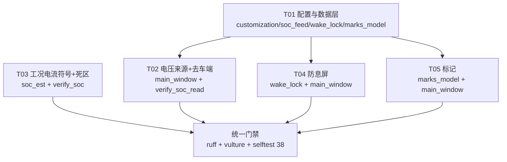

# SerialAssistant 4 项增量需求 —— 系统设计与任务分解

> 架构师：高见远（Bob）　基线：已发布 v2.10，本地 HEAD `46b66bb`，自测 38/38 全绿
> 环境：`.venv\Scripts\python.exe`（系统 Python 无 PySide6），真平台 `QT_QPA_PLATFORM=windows`
> 约束：只做设计，不改产品源码、不 git、不打包、不动 `发布/` 与 `dist*`
> 配套图：`docs/class-diagram.mermaid`、`docs/sequence-diagram.mermaid`

---

## Part A：系统设计

### 1. 实现方案

四项功能互相独立，共用一套既有基础设施：`customization` 注册表（QSettings）、
`main_window` 的底栏 SOC 渲染链与接收区高亮链、`soc_est`/`soc_feed` 纯算法层。
逐项说明接口、状态与调用流程。

---

#### 1.1 需求 1：电压来源可选 + 去掉「车端」二字

**现状事实（带 file:line）**

- `soc_source` 注册于 `customization.py:387-390`，选项文案 `("本地估算","calc") / ("车端 BMS","read")`。
- 底栏四枚标签 `lbl_soc_mode/min/max/volt` 建在 `main_window.py:1571-1602`；`lbl_soc_volt`
  tooltip 在 `:1598`（「总电压按清洗后电芯平均值 × 串数估算」）。
- 渲染唯一出口 `_render_soc`（`:8724-8736`）→ `_soc_read_parts`（`:8738-8756`）→
  `_soc_placeholder`（`:8758-8762`）。`read` 模式把 min 槽换成 `车端 SOC xx%`，max 槽清空，
  **总压槽照抄 calc 的** `parts[3]`。
- 数据来源切换：`_load_soc_source`/`_set_soc_source`（`:8764-8782`）、`_refresh_soc_now`（`:8784-8793`）、
  设置面板预览 `_preview_custom`（`:9637-9639`）、取消还原（`:9519`）、确定落地（`:9585-9589`）、
  打开面板记旧值（`:8985`、字段声明 `:875`）。
- `SocResult.pack_v` 由 `soc_est.py:521-527` 的 `clean.pack.mean_mv × 串数` 得来，
  `format_soc_parts`（`:1223-1239`）第 4 槽是 `f"总电压 {res.pack_v:.1f} V"`。
- 报文 `V=` 行：`soc_feed.py:49` `CVI_RE` 已解析 `group(1)`，但 `:261-270` **刻意丢弃**（传感器恒 0.00），
  `RoundData`（`:95-116`）**没有** `v_read` 字段，`__slots__` 在 `:98-99`。
- `SOC=` 粘滞机制：`last_soc_read`（`:149`、`:200-205`），
  `main_window._feed_soc` 在 `:8665-8666` 同步，空轮补刷在 `:8667-8673`。

**设计决策（已拍板，不再询问）**

1. **复用 `soc_source` 的二选一机制**，新增独立键 `volt_source`（`custom/volt_source`，默认 `calc`）。
   ⛔ 绝不复用 `soc_source` 的值：SOC 与电压要能各自独立选来源。
2. **「读取到的电压」= `V=` 行原始文本**（已知恒 `0.00`），界面照实显示，**不得**回退到计算值。
   `V=` 在 `CVMax=` **之前**到达（见 `soc_feed.py:16-17` 的段布局），所以按轮采集即可，
   但为对齐 `SOC=` 的粘滞稳健性（分包可能把它切到下一块），同样做一份粘滞 `last_v_read`。
3. **界面禁止「车端」二字**：两处下拉选项统一为
   `("本地估算","calc") / ("BMS 上报","read")`；所有用户可见文案 `车端 SOC` → `BMS SOC`。

**接口 / 状态清单**

- `soc_feed.py`
  - `RoundData.__slots__` 增 `v_read`；`__init__` 增 `self.v_read: str | None = None`（原始文本，保留 `0.00` 的写法）。
  - `RoundCollector.__init__` 增 `self.last_v_read: str | None = None`；`reset()`（`:154-164`）清零。
  - `_feed_line` 的 `cvi` 分支（`:261-270`）：把 `cvi.group(1)` 原文同时写入 `self._round.v_read`
    与 `self.last_v_read`；仍保留 `float(cvi.group(1))` 的格式校验（坏行不污染 `i_meas`）。
  - `_finish`（`:325-330`）无需改：`v_read` 已随轮带走。
- `customization.py`
  - 改写 `soc_source` 选项文案为 `本地估算 / BMS 上报`（值 `calc`/`read` 不变 → 现有用户设置不失效）。
  - 新增 `register_choice("volt_source", "总电压来源", "calc", (("本地估算","calc"),("BMS 上报","read")), tip=...)`，
    tip 必须写明「BMS 上报」= 报文 `V=` 原始值、该传感器恒报 `0.00`、界面照实显示。
- `main_window.py`
  - 新增实例态（`:1648-1652` 附近）：`self._volt_source = self._load_volt_source()`（`calc`/`read`）、
    `self._volt_read_last: str | None = None`、`self._volt_read_last_shown`；
    `_init_soc`（`:8601-8608`）重置这两个读数。
  - 新增方法（签名）：
    - `_load_volt_source(self) -> str`（仿 `:8764`）
    - `_set_volt_source(self, value) -> None`（仿 `:8772`，同样只重绘不重建估算器）
    - `_volt_part(self, parts: tuple) -> tuple[str,str,str,str]`：只替换 `parts[3]`；
      `read` 且有读数 → `f"总电压 {self._volt_read_last} V"`，无读数 → `总电压 -- V`；
      `calc` → 原样返回。
  - 改 `_render_soc`（`:8724-8736`）：先按 `_soc_source` 走既有逻辑，再无条件 `parts = self._volt_part(parts)`。
    ⚠️ `_soc_read_parts` 里 `volt_text = parts[3]`（`:8752`）要保留，由 `_volt_part` 在其后覆盖，顺序不能反。
  - 改 `_feed_soc`（`:8650-8686`）：`rounds=[]` 分支里在同步 `_soc_read_last` 之后同步
    `self._volt_read_last = self._soc_feed.last_v_read`，并把它纳入 `:8667-8669` 的「值变了就补刷」判据；
    循环内若有 `data.v_read is not None` 也同步。
  - 改 `_soc_placeholder`（`:8758-8762`）：`read` 模式的第 4 槽按 `_volt_source` 给 `总电压 -- V` 或空串。
  - 改 `lbl_soc_volt` tooltip（`:1598`）为按来源解释（不再只说清洗均值）。
  - 设置面板三处联动全部加 `volt_source`：`_settings_volt_source_prev`（`:875` 旁）、
    `_open_settings`（`:8985`）、`_apply_settings_result` 取消（`:9519`）与确定（`:9585-9589`）、
    `_preview_custom`（`:9637-9639`）。⛔ 照 `soc_source` 的模式加**独立字段**，
    不要塞进 `_settings_previous` 元组（其解包点在 `:9510-9511`，加字段会漏改 ValueError）。
  - 文案清理（仅 UI 可见字符串，注释/docstring 可选）：`main_window.py:8754-8755,8761,9589`、
    `customization.py:377-390` 注释、`selftest.py:3497` 断言、`devtools/_verify_soc_read.py:317,340-341,354-355`。

**调用流程**（详见 sequence-diagram.mermaid「收一帧」段）
`_emit_block(raw)` → `_feed_soc(raw)` → `RoundCollector.feed`（存 `v_read` / `i_meas` / `soc_read`）
→ `_apply_soc` 生成 calc parts 并缓存 `_soc_calc_last` → `_render_soc` 依次套 SOC 来源、电压来源 → `_set_soc_parts`。

---

#### 1.2 需求 2：工况识别改为电流符号为主 + 死区

**现状事实**

- 常量 `soc_est.py:212-218`：`MODE_V_WINDOW_S=60`、`MODE_V_DELTA_MV=3`、`MODE_HOLD_S=30`、`MODE_I_MIN_A=1.2`；
  `REST_I_MAX_A=1.2` 在 `:335`。
- `WorkModeClassifier`（`:229-305`）：`_hist`（`:243`）、`_trend`（`:251-270`）、`_set`（`:272-284`）、
  `classify`（`:286-305`）。判序：`mean<=0→unknown(force)` → `open→open(force)` → `!bms_ok→unknown(force)`
  → `i_valid & |i_eff|>MODE_I_MIN_A → 符号` → `_trend down/up → 符号` → `idle`。
- 唯一调用点 `SocEstimator.update` 的 `:919-925`（每轮只调一次，注释强调）。
- ⛔ P1 判序在 `_effective_current`（`:1068-1103`），其中 `:1091` `contactor_open is True` 必须排在
  `:1098` `abs(raw)>I_LIMIT_A` 之前 —— **本需求不碰这个函数**。
- 自测 `devtools/_verify_soc.py:1135-1215` M1~M12，其中 M5/M6 依赖 `_trend` 兜底、
  M4 依赖 `!bms_ok→unknown`；M11 断言 `not c._hist`。

**设计决策（用户已定 + 我据规则细化）**

- 用户已定：`|I| > 阈值` → 正=放电 / 负=充电；`|I| < 阈值` → 静置；保留 `open` 硬约束与短滞回；**删除电压趋势兜底**。
- 待明确项逐条决策（理由见 §5）：
  1. **死区阈值独立常量 `MODE_I_DEADBAND_A = 1.2`**（`soc_est.py`，紧邻 `MODE_I_MIN_A`），
     ⛔ 不复用 `REST_I_MAX_A`（虽然同为 1.2，语义不同：静置锚定 vs 工况死区，改一个不应牵动另一个）。
     `MODE_I_MIN_A` 保留但不再用于 `classify`（避免破坏可能引用它的外部探针）。
  2. `i_valid=False` / 缺 `I=` 字段 → **返回 `idle`（静置）**，不再走电压趋势；因为电流无效等价于"没有显著功率流"，
     且电压趋势已删，没有别的证据支撑放/充电。
  3. `bms_ok=False` 但母线未断 → **仍按电流判**：删掉 `if not bms_ok: return unknown` 这一 force 分支
     （`:296-297`），让电流符号成为主判据。`mean<=0→unknown` 保留（无有效电压数据＝无法估算）。
  4. 滞回 `_hold_until` 与 `_set`（`:272-284`）**原样保留**：只在 `new ∈ {idle,open,unknown}` 且
     `ts < _hold_until` 时挡住回落；`open` 仍 `force=True` 不受滞回影响（保 M10）。
  5. 删除 `_hist`、`_trend`、`MODE_V_WINDOW_S`、`MODE_V_DELTA_MV`（若 selftest/devtools 无引用；
     经查仅 `_verify_soc.py` M5/M6/M11 引用，见文件清单）。

**新 `classify` 伪码**（签名保持不变，调用点 `:923-925` 一行都不用改）

```
def classify(self, ts, mean_mv, i_eff, i_valid, contactor_open, bms_ok) -> str:
    if mean_mv <= 0:                       return self._set("unknown", ts, force=True)  # 保留
    if contactor_open is True:             return self._set("open",    ts, force=True)  # 硬约束，最高
    # bms_ok 不再否决；i_valid=False 视为死区内
    if i_valid and abs(i_eff) > MODE_I_DEADBAND_A:
        return self._set("discharge" if i_eff > 0 else "charge", ts)
    return self._set("idle", ts)           # 死区内 / 电流无效 / BMS 报错但母线未断
```
判序铁律：母线全断用 `force=True` 置 `open`，任何电流读数都压不过它；`_effective_current` 的
P1 判序（`:1091` 先于 `:1098`）完全不动。

---

#### 1.3 需求 3：开关控制「读串口期间电脑不息屏」

**现状事实**

- 串口开关：`btn_open`（`main_window.py:1961-1965`）→ `_on_power_toggled`（`:6329-6339`）→
  `_open_port`（`:6341-6394`）/ `_close_port`（`:6510-6547`）；
  连接成功的唯一确认点是 `_on_port_opened`（`:6405-6432`，`_port_connected=True` 在 `:6411`）。
  异常路径 `_on_open_failed`（`:6466-6508`）、`_abort_open`（`:6396-6403`）也会把开关弹回。
- 程序退出：`closeEvent`（`:10179-10222`），清理段在 `:10200-10221`。
- 既有 ctypes 用法：`devtools/_probe_live_veh.py:69-70`、`_check/_burst.py:28`
  用 `SetThreadExecutionState(0x80000000|1|2)`；`drv_assist.py:388-402` 用
  `ctypes.WinDLL("kernel32", use_last_error=True)` 并声明 argtypes（正确范式）。

**设计决策**

- 新增**纯逻辑模块** `wake_lock.py`（无 Qt、可脱离界面单测），封装 Windows 线程执行状态：
  - 类 `WakeLockState`（或模块级函数 + 注入的 setter），状态：`enabled: bool`（设置开关）、
    `receiving: bool`（串口是否在接收）、`held: bool`（是否已 acquire）。
  - 接口：`configure(enabled)`、`set_receiving(active)`、`release()`、`_sync()`。
    `_sync`：`want = enabled and receiving`；仅当 `want != held` 时调 OS（幂等，避免每帧重复设）。
  - OS 调用（注入点，便于 selftest 不打真电源策略）：
    `_acquire` → `SetThreadExecutionState(0x80000000 | 0x1 | 0x2)`；
    `_release` → `SetThreadExecutionState(0x80000000)`。
    用 `ctypes.windll.kernel32`，`argtypes=[wintypes.DWORD], restype=wintypes.DWORD`；
    `sys.platform != "win32"` 时整段降级为 no-op（打日志）。
  - ⛔ 不做定时器轮询：状态只在「开关改 / 串口开成功 / 串口关闭 / 退出」四个离散事件翻。
- 新设置 `register_bool("keep_awake_on_rx", "读串口时保持屏幕唤醒", False, tip=...)`
  （`customization.py`，默认 False = 与现状一字不差）。
- `main_window.py` 接线（5 个点，全部幂等）：
  - `__init__`（`:948` 附近）建 `self._wake_lock` 并按 `customization.get("keep_awake_on_rx")` 初始化。
  - `_on_port_opened`（`:6411` 之后）`set_receiving(True)`；BLE 分支 `:6412-6419` 也要覆盖
    （它是 `return` 早退，调用必须放在 `:6411` 之后、`return` 之前）。
  - `_close_port`（`:6515` 之后）与 `_on_open_failed`（`:6473` 之后）`set_receiving(False)`。
  - `closeEvent` 清理段（`:10217` 附近）`release()`（强制恢复默认，即使 receiving 仍为真）。
  - `_apply_settings_result`（`:9525-9604`）处理 `keep_awake_on_rx` 变化 → `configure(...)`。
  - 可选预览：`_preview_custom`（`:9637` 旁）加 `keep_awake_on_rx` 分支即时 configure；若不做预览，
    则必须在取消分支（`:9507-9520`）还原旧值 —— 二选一，写明在共享约定里。
- 异常退出：OS 在线程/进程结束时自动释放执行状态，不会永久改电源策略 —— 在 docstring 与 tip 里说明即可。
- 自测点：`wake_lock.py` 纯函数单测（可注入 fake OS setter，断言 acquire/release 次数与 flag 值），
  ⛔ 真 selftest 里不要真的调用 `SetThreadExecutionState`（会改测试机电源策略）——用依赖注入的假 setter。

---

#### 1.4 需求 4：标记功能（按钮打标 + 列表跳转 + 按整轮）

**现状事实（关键：复用，不另起一套）**

- 接收区 `QPlainTextEdit` = `self.txt_rx`。
- 轮边界已有 `_round_span(from_block) -> (start,end) | None`（`main_window.py:7330-7350`）：
  向上找最近时间戳行、向下找下一个，返回整轮块区间；`stamp_span`（`ui_highlight.py:165-170`）判时间戳行。
- 「当前轮」定位已有 `_viewed_block_number()`（`:7441-7457`，视口中点，符合"复制当前轮"口径）与
  `_top_block_number()`（`:2680`）；`_copy_all_receive`（`:7459-7501`）就是复用 `_round_span` 的现成范例。
- 高亮已有 `_make_selection(cursor, color) -> ExtraSelection`（`:2909-2920`）、
  `_set_search_selections`（`:7800-7802`）、`_apply_extra_selections`（`:7804-7813`，
  合并 `_search_selections` + `_alert_selection` 后一次性 `setExtraSelections`）、
  `_clear_alert_highlight`（`:7792-7798`）。
- 滚动定位已有 `_visual_line_index(block_number, row_height)`（`:7419-7439`）、
  `_locate_last_error`（`:7602-7631`，`scrollbar.setValue(...)` + 整行高亮 + `_search_pinned=True`）。
- 右侧竖排按钮栏：`main_window.py:2297-2341`，7 颗按钮在 `:2330-2333` 的 for 循环里 addWidget。
- 回放态：`self._replay_active`（`:965`），`_enter_replay`（`:8040-8086`）用 `setPlainText` 整体换文档、
  `_exit_replay`（`:8088-8098`）`_clear_receive`；`setMaximumBlockCount` 实时 `self._rx_blocks`、
  回放 `REPLAY_MAX_BLOCKS`（`:8068`）。
- 「清空接收区」`_clear_receive`（`:7510-7538`）是标记生命周期的天然清理点。

**设计决策（用户已定）**：工具栏一颗「标记」按钮；侧栏列出标记、点击跳回并高亮**整轮**；
支持上/下一个标记快捷键；按整轮为单位；**不框选文本**；**不持久化**（仅本次会话，重启清空）。

**数据结构（建议 `list[RoundMark]`）**

- 纯数据模块 `marks_model.py`（新建，无 Qt，便于单测）：
  - `@dataclass(frozen=True) class RoundMark:` 字段
    `key: str`（稳定键 = `f"{stamp}#{seq}"`，`stamp` 是轮首时间戳文本）、
    `start_block: int`（打标时的轮首块号，仅作快速路径）、
    `stamp: str`（轮首块文本，用于被裁剪后重定位）、
    `summary: str`（轮首后首个非空行的前 24 字，列表展示用）、
    `seq: int`（会话内自增，处理同一时间戳重复）。
  - `class MarkStore`: `marks: list[RoundMark]`、`current: int`；
    方法 `add(start, stamp, summary) -> RoundMark`、`clear()`、
    `nearest_key(block) -> str | None`（向上找 `start_block<=block` 的最近一个）、
    `by_key(key) -> RoundMark | None`、`next/prev() -> RoundMark | None`（循环）。
- `main_window.py` 侧只持有 `self._marks = MarkStore()` 与 `self._mark_selection: ExtraSelection | None`；
  ⛔ 不进 QSettings、不进 `customization` 注册表、不写盘（重启即空）。

**接口 / 状态（新增函数签名，均在 main_window.py）**

- `_build_rx_rail` 内联处（`:2297-2341`）：在 for 循环加 `self.btn_mark =
  IconButton(GLYPH_ADD, "标记当前轮（Alt+M）", size=30, glyph_size=15)`，
  `clicked.connect(self._mark_current)`；`GLYPH_ADD` 已在 `ui_theme.py:355` 定义，需加进 `:80-87` 的 import。
  ⛔ 不进 `BUTTON_SPECS`（`:313-321`）—— 那是「可隐藏按钮」清单，标记按钮是核心操作，不允许隐藏。
- 右侧列表 UI：新增 `self._mark_panel` / `self._mark_list`（`QListWidget` 或自绘 `QWidget`），
  放在 `self._rx_rail`（`:2336-2341`）旁边或 `_search_bar` 同级的 `left` 布局；
  需要在 `PySide6.QtWidgets` import（`:32-35`）加 `QListWidget`/`QListWidgetItem`（若用）。
  点击项 → `self._jump_to_mark(row)`。列表在 `_replay_active` 时禁用/隐藏。
- `_mark_current(self) -> None`：
  `span = self._round_span(self._viewed_block_number())`；`None` → toast「当前没有可标记的轮次」并 return；
  否则取 `stamp = document.findBlockByNumber(span[0]).text()`、
  `summary =` 从 `span[0]+1` 起首个非空行 `[:24]`，`self._marks.add(...)`，刷新列表。
- `_refresh_mark_list(self) -> None`：按 `self._marks.marks` 重建列表项（文本用 `stamp + " " + summary`）。
- `_jump_to_mark(self, key: str) -> None`：
  1. `mark = self._marks.by_key(key)`；先试 `doc.findBlockByNumber(mark.start_block)`，
     若其文本 `== mark.stamp` 则直接用；否则全篇扫 `stamp_span` 命中的块文本找相等者（裁剪兜底）。
  2. 找不到 → toast「该标记对应的数据已被裁剪，无法跳回」，return（不崩、不误跳别的轮）。
  3. 找到 `round_start` → `span = self._round_span(round_start)` → 用 `_visual_line_index` 算滚动值、
     `self._search_pinned = True`（否则实时数据把视图甩走）。
  4. **高亮整轮**：构造 `cursor = QTextCursor(doc)`，
     `cursor.setPosition(doc.findBlockByNumber(span[0]).position())`，
     `cursor.setPosition(doc.findBlockByNumber(span[1]-1).position() + ...length(), KeepAnchor)`，
     `self._mark_selection = self._make_selection(cursor, QColor(qcolor("temp_warn")) with alpha=ALERT_FILL_ALPHA)`，
     调 `_apply_extra_selections()`。⛔ 这是 ExtraSelection 背景色，**不是** `setTextCursor` 的选区 —— 满足"不框选文本"。
- `_apply_extra_selections`（`:7804-7813`）：合并列表增加 `self._mark_selection`（非 None 时 append）。
- `_clear_mark_highlight(self) -> None`（仿 `_clear_alert_highlight`）：清 `self._mark_selection` 并重刷。
- 生命周期清理：`_clear_receive`（`:7510-7538`）末尾加 `self._marks.clear()` + `_clear_mark_highlight()` + 清空列表；
  `_enter_replay`（`:8040-8086`）换文档处（`:8053` 附近）同样清理 —— **回放态不支持标记**，
  按钮/列表置灰并 tooltip 说明（理由见 §5）。
- 快捷键（`_wire_shortcuts`，`:2498-2503` 附近）：
  `QShortcut(QKeySequence("Alt+M"), self, self._mark_current)`、
  `Alt+Up` / `Alt+Down`（或 `Ctrl+Shift+Up/Down`，避开已有 `Ctrl+F/L/Return`、`F11`、`Escape`）→
  `self._goto_mark(-1/+1)`；`_goto_mark(step)` 调 `_marks.next/prev` 再 `_jump_to_mark`。
  ⛔ 与搜索框的 `Enter/Shift+Enter`（`:2386-2387`）不冲突即可。

**裁剪兜底**：标记存 `stamp` 文本而非只存块号；跳转时块号对不上就按 `stamp` 全文重定位；
重定位失败只提示、不误跳。`setMaximumBlockCount` 从头裁（MEMORY 已载），因此这是唯一可靠的兜底。

---

### 2. 文件清单（相对路径 + 每处改什么）

> 严格标注文件边界，便于并行分工。`(新)` = 新增文件。所有行号基于 HEAD `46b66bb`。

| 文件 | 需求 | 改动点（含新增函数签名） |
|---|---|---|
| `customization.py` | 1,3 | `:387-390` 改 `soc_source` 选项文案为「本地估算/BMS 上报」（值不变）；紧随其后新增 `register_choice("volt_source","总电压来源","calc",(("本地估算","calc"),("BMS 上报","read")),tip=...)`；在 bool 区（`:358` 附近）新增 `register_bool("keep_awake_on_rx","读串口时保持屏幕唤醒",False,tip=...)`。⛔ 只加新键，不改任何现有键的 key/默认值/语义。 |
| `soc_feed.py` | 1 | `:98-99` `RoundData.__slots__` 加 `"v_read"`；`:101-110` `__init__` 加 `self.v_read: str\|None=None`；`:132-150` `RoundCollector.__init__` 加 `self.last_v_read`；`:154-164` `reset()` 清零；`:261-270` `cvi` 分支把 `cvi.group(1)` 原文写入 `self._round.v_read` 与 `self.last_v_read`（保留 float 校验）。 |
| `soc_est.py` | 2 | `:218` 后新增 `MODE_I_DEADBAND_A = 1.2`；`:212-213` 的 `MODE_V_WINDOW_S`/`MODE_V_DELTA_MV` 删除（确认无引用后）；`:243` 删 `_hist`、`:251-270` 删 `_trend`、`:248` 删 `reset` 里的 `_hist.clear()`；`:286-305` 按 §1.2 伪码重写 `classify`（删 `bms_ok` 否决分支与 trend 兜底，改用 `MODE_I_DEADBAND_A`，`i_valid=False→idle`）。⛔ `:1068-1103` `_effective_current` 一字不动。 |
| `main_window.py` | 1,3,4 | **需求1**：`:1648-1652` 加 `_volt_source/_volt_read_last/_volt_read_last_shown`；`:8601-8608` 重置；新增 `_load_volt_source()->str`、`_set_volt_source(value)->None`、`_volt_part(parts)->tuple`；改 `_render_soc:8724-8736`、`_feed_soc:8650-8686`、`_soc_placeholder:8758-8762`、`lbl_soc_volt tooltip:1598`；文案 `:8754-8755,8761,9589`；设置联动 `:875,8985,9519,9585-9589,9637-9639`。**需求3**：`:948` 建 `self._wake_lock`；`:6411` 后、`:6515` 后、`:6473` 后、`:10217` 附近、`:9525-9604` 五处接线。**需求4**：`:80-87` import `GLYPH_ADD`、`:32-35` import `QListWidget`；`:2297-2341` 加 `btn_mark` 与列表；新增 `_mark_current()->None`、`_refresh_mark_list()->None`、`_jump_to_mark(key)->None`、`_goto_mark(step)->None`、`_clear_mark_highlight()->None`；改 `_apply_extra_selections:7804-7813`、`_clear_receive:7510-7538`、`_enter_replay:8053` 附近、`_wire_shortcuts:2498-2503`。 |
| `marks_model.py` | 4 | `(新)` `@dataclass(frozen=True) class RoundMark(key,start_block,stamp,summary,seq)`；`class MarkStore`：`marks`、`current`、`add(start,stamp,summary)->RoundMark`、`clear()`、`nearest_key(block)->str\|None`、`by_key(key)->RoundMark\|None`、`next()->RoundMark\|None`、`prev()->RoundMark\|None`。纯 Python，无 Qt。 |
| `wake_lock.py` | 3 | `(新)` `class WakeLock`：`enabled/receiving/held`；`configure(enabled:bool)->None`、`set_receiving(active:bool)->None`、`release()->None`、`_sync()->None`、`_acquire(os_setter=None)->None`、`_release(os_setter=None)->None`。`OS_SET` 默认 `ctypes.windll.kernel32.SetThreadExecutionState`，可注入；非 Windows no-op。 |
| `selftest.py` | 1,2,3,4 | `:3497` 断言语改为 `["本地估算","BMS 上报"]`；新增：voltage 选项存在性、M 系列改为死区/电流符号/无 bms_ok 否决的期望、`wake_lock` 纯单测、`marks_model` 纯单测。⛔ 断言不写死用户可配置数值：读 `customization.get()`/`soc_est` 常量反断言。 |
| `devtools/_verify_soc_read.py` | 1 | `:317,340-341,354-355` 的 `车端 SOC` → `BMS SOC`；新增 `volt_source=read` 分支断言「总压槽 = 原始 V= 值」与 calc 分支对照、切换往返一致。 |
| `devtools/_verify_soc.py` | 2 | `:1135-1215` M 系列：删/改 M5、M6（trend 兜底已删，改为断言 `i_valid=False→idle`）、M11（`not c._hist` → 断言 `_set` 状态已清）；M4 期望由 `unknown` 改为按电流符号（如 `-12A` → `charge`）；新增死区边界、`i_valid=False`、`bms_ok=False 但母线未断按电流判`、`open` 不受滞回影响等用例。 |
| `devtools/_verify_soc_display.py` | 1,2 | 若其对 `format_soc_parts`/mode 分布有契约断言（`:251,271`），确认 voltage 来源与工况改动后仍逐字通过；必要时加 voltage read 显示断言。 |

---

### 3. 程序调用流程

完整时序见 `docs/sequence-diagram.mermaid`（含启动读配置、打开串口、收一帧、打标、跳转、退出恢复六段）。
类关系与契约见 `docs/class-diagram.mermaid`（五项功能涉及的模型/服务类与复用关系）。

---

### 4. 待明确事项（Anything UNCLEAR）

见 Part B §11「风险与待明确」——已按用户决策收敛，仅保留必须让用户知情的三点（电压恒 0V 预期、
工况死区与 bms_ok 行为、回放态标记禁用）。

---

## Part B：任务分解

### 5. 依赖包（Required Packages）

**无需新增第三方依赖。** 四项功能全部落在现有栈内：

- PySide6（已装）：`QListWidget`、`QShortcut`、`QTextCursor.ExtraSelection` 均为既有模块。
- 标准库 `ctypes` / `wintypes`：`wake_lock.py` 调 `SetThreadExecutionState`，已在 `drv_assist.py` 用过。
- 纯 Python：`soc_est.py` / `soc_feed.py` / `marks_model.py`，无新依赖。
- ⛔ 不引入 numpy 之外的数值库（项目已在 slim-numpy 中收敛）。

---

### 6. 有序任务列表（按依赖排序，≤5 个）

| ID | 任务名 | 源文件 | 依赖 | 优先级 | 可并行 |
|---|---|---|---|---|---|
| T01 | 配置与数据层：新增三个键 + RoundData.v_read + 新纯模块 | `customization.py`、`soc_feed.py`、`wake_lock.py`(新)、`marks_model.py`(新) | — | P0 | 是（无 UI 依赖，纯逻辑，可先落） |
| T02 | 需求1：电压来源可选 + 去掉「车端」UI 文案 | `main_window.py`、`soc_feed.py`(T01 已改)、`customization.py`(T01 已改)、`devtools/_verify_soc_read.py`、`selftest.py` | T01 | P0 | 与 T03/T04/T05 文件不重叠处可并行；`main_window.py` 由 T02/T03/T04 共用 → 见 §7 |
| T03 | 需求2：工况电流符号 + 死区，删电压趋势兜底 | `soc_est.py`、`devtools/_verify_soc.py`、`devtools/_verify_soc_display.py`、`selftest.py` | — | P0 | 是（纯算法 + devtools，不碰 `main_window.py`） |
| T04 | 需求3：读串口期间防息屏 | `wake_lock.py`(T01 已建)、`main_window.py`、`customization.py`(T01 已改)、`selftest.py` | T01 | P1 | 与 T02/T05 同改 `main_window.py` → 串行或分片 |
| T05 | 需求4：标记按钮 + 侧栏 + 整轮跳转 | `marks_model.py`(T01 已建)、`main_window.py`、`selftest.py` | T01 | P1 | 与 T02/T04 同改 `main_window.py` → 串行或分片 |

**建议实现顺序**：`T01 → (T02 ∥ T03) → T04 → T05`。
T03 完全独立（纯 `soc_est.py` + devtools），可与 T01 之后的任意任务并行；
T02/T04/T05 都改 `main_window.py` 的不同区域（SOC 渲染段 / 串口回调段 / 右侧栏与快捷键段），
**若多人并行，按函数边界分片改，最后统一跑一次 selftest**，避免同一文件写冲突。

---

### 7. 任务依赖图



---

### 8. 共享约定（跨文件，工程师必读）

**QSettings 键（只加新键，⛔ 绝不重置用户设置）**

- 新增 `custom/volt_source`（`calc`/`read`，默认 `calc`）—— 与 `soc_source` **各自独立**，互不复用。
- 新增 `custom/keep_awake_on_rx`（bool，默认 `False`）。
- 标记功能 **零键**：仅内存，重启/清屏/进回放即空。
- `soc_source` 的**存储值 `calc`/`read` 不变**，只改显示文案 → 老用户设置自动沿用（`customization.get` 的 choice 归一见 `:111-115`）。
- ⛔ 探针收尾还原 QSettings、`app.quit()`、不 `os._exit()`；别两进程同时跑 selftest（互踩 QSettings）。

**措辞（全项目统一，界面不许出现「车端」）**

- 下拉选项：`本地估算`（`calc`）/ `BMS 上报`（`read`），SOC 与电压两组一致。
- 底栏 read 模式：`BMS SOC xx.xx%`；无读数 `BMS SOC --`。
- 总压 read 模式：`总电压 {V=原始文本} V`（如实显示 `0.00`）；无读数 `总电压 -- V`。
- 工况文案沿用 `soc_est.MODE_LABELS`（`:220-226`），不新增。

**跨文件常量**

- 死区 `soc_est.MODE_I_DEADBAND_A = 1.2`（与 `REST_I_MAX_A` 解耦，各自独立）。
- 滞回 `MODE_HOLD_S = 30` 不变；`open` 仍 `force=True` 最高优先级。
- 防息屏 flag：`ES_CONTINUOUS=0x80000000`、`ES_DISPLAY_REQUIRED=0x1`、`ES_SYSTEM_REQUIRED=0x2`。
- 高亮：整轮用 `ExtraSelection` 背景色（复用 `_make_selection` + `qcolor("temp_warn")` + `ALERT_FILL_ALPHA=46`，
  `main_window.py:297`），⛔ 不用真实选区（"不框选文本"）。

**数据来源与时序铁律**

- `V=`/`SOC=`/`I=` 必须在 `align_indexes` 之前取原始文本（`_emit_block:7022-7025` 的顺序不动）。
- `SOC=` 在 `CVMax=` 之后到 → 靠粘滞；`V=` 在 `CVMax=` 之前 → 按轮即可，另做粘滞兜底。
- `_render_soc` 是底栏文本**唯一出口**：先套 SOC 来源、再套电压来源，顺序不可反。
- `_apply_extra_selections` 是 `setExtraSelections` **唯一出口**：搜索 + 告警 + 标记合并后一次下发。

**提交门禁**

- `.venv\Scripts\python.exe -m ruff check --select F,E7,E9,W6 <改动模块>` 干净；`vulture` 无新增假阳性；
  `QT_QPA_PLATFORM=windows .venv\Scripts\python.exe selftest.py` **38 条全绿**（新增断言后按新总数）。
- ⛔ selftest 只跑完整入口；不两进程同跑；几何断言必须真平台。
- ⛔ 冻结产物：改源码后 `发布/` 与已验证 dist 的 exe 即过期，需重打包才发版（本次设计不打包）。

**自测新增点（汇总）**

1. 电压：选项存在且文案无「车端」；`RoundData.v_read` 拿到 `0.00`；read/calc 切换往返文本一致。
2. 工况：死区边界（`|I|=1.2` 静置，略大按符号）、`i_valid=False→idle`、`bms_ok=False 但母线未断按电流`、
   `open` 压过电流且不受滞回、无 `MODE_V_*` 残留引用。
3. 防息屏：`wake_lock` 纯单测（注入 fake OS setter，断言 acquire=1/release=1、幂等、非 Windows no-op）。
4. 标记：`MarkStore` add/clear/nearest/next/prev；整轮 ExtraSelection 覆盖 `[span0,span1)`；裁剪后按 `stamp` 重定位；
   清屏/进回放后标记清空；回放态按钮禁用。

---

### 9. 风险与待明确（重点三项）

1. **电压显示恒 0V 的用户预期（需求1）**：用户已知传感器恒报 `0.00` 并坚持直显。
   设计如实展示，⛔ 工程师不得"贴心"回退到清洗均值。需在下拉 tip 与 tooltip 写明
   「"BMS 上报"= 报文 `V=` 原始值，该路恒为 0.00，界面照实显示；如需可用值请切「本地估算」」，
   避免用户误以为软件坏了。风险：底栏同时出现「BMS SOC 正常 / 总电压 0.00 V」会让人困惑 —— 这是知情选择，不修。

2. **工况阈值与 bms_ok 行为变更（需求2）**：死区 `1.2A` 与 `open` 硬约束保留；
   但 `i_valid=False→idle`、`bms_ok=False 但母线未断→按电流判` 是行为变更，
   会让真机（母线全断、BMS Error、`I=-250` 轨值）继续显示 `母线断开`（未被滞回挡，`force=True`），
   而"母线未断但 BMS 报错"的少数帧由 `unknown` 变 `idle`/`充放电`。
   `devtools/_verify_soc.py` 的 M4/M5/M6/M11 必须同步重写，否则回归红。
   ⛔ 不得为"让测试过"改 `_effective_current` 的 P1 判序。

3. **标记在回放态的行为（需求4）**：回放用 `setPlainText` 整体换文档且分页前插，块号剧烈漂移，
   标记的 "当前轮" 与跳转锚点在回放里不可靠。**决策：回放态禁用标记**（按钮/列表置灰 + tooltip 提示
   「回放中不支持标记，返回实时后可用」），进入/退出回放都清空标记。
   如用户坚持回放也要标记，再单独评估按"时间戳字符串"而非块号做锚 —— 本次不做。

**其他次要风险**

- `setMaximumBlockCount` 实时态从头裁：标记必须存 `stamp` 文本做兜底重定位，找不到只提示不误跳。
- `wake_lock` 的 `SetThreadExecutionState` 是**每线程**状态：acquire/release 必须在同一线程调用
  （都在 GUI 主线程，满足）；异常退出由 OS 回收，不会永久改电源策略。
- `VOLT_SOURCE` 与 `SOC_SOURCE` 独立：设置面板预览/取消要各自记旧值，漏一个会出现"点了取消却变了"。
